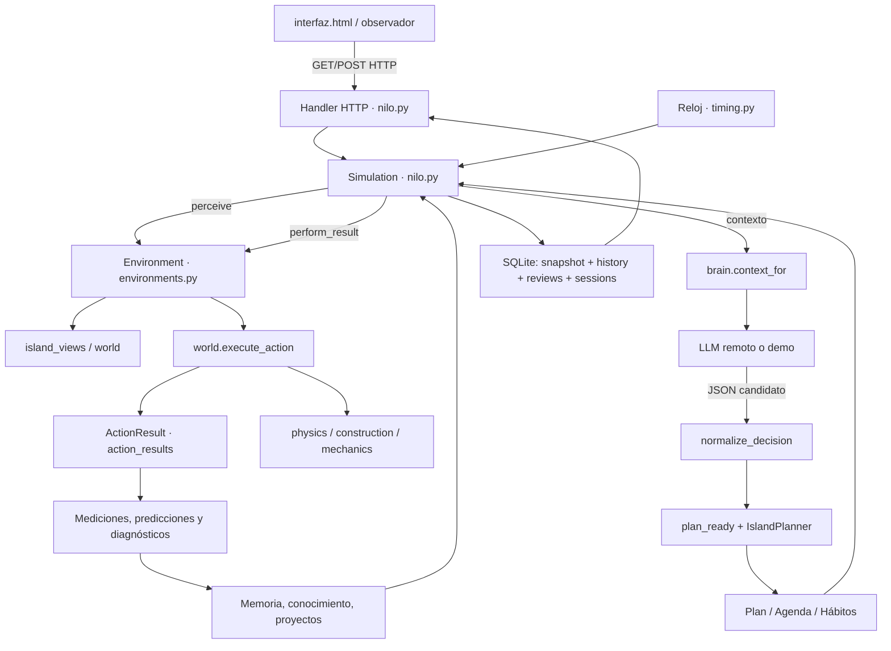

# Nilo — Referencia técnica integral

> **Estado auditado:** código de `main` de `mxlzz/Nilo`, **0.5.9.3.13**, consultado el **31 de octubre de 2026**.  
> **Propósito:** explicar el funcionamiento real de Nilo desde una sola lectura: arquitectura, datos, decisiones, reglas, ejecución, resultados, memoria, interfaz, persistencia, configuración, pruebas y límites.  
> **Criterio de verdad:** cuando difieren el README, un documento histórico y el código, esta referencia describe **el código ejecutable**; las aspiraciones se identifican expresamente como *futuras*.  
> **Alcance:** inventario funcional exhaustivo de los módulos de la versión examinada, sus principales variables, reglas y relaciones. No es una reproducción línea por línea de los fuentes ni una garantía de ausencia de defectos; los detalles normativos definitivos siguen siendo las funciones y pruebas enlazadas.  
> **Convención:** las unidades de las propiedades de los materiales y las magnitudes físicas son **abstractas**, salvo indicación expresa. «Verificado» significa verificado **dentro de las reglas del simulador**, no científicamente en el mundo real.

## Índice de lectura

1. [Qué es Nilo y qué hace cada capa](#1-qué-es-nilo-y-qué-hace-cada-capa)
2. [Arquitectura completa y flujo causal](#2-arquitectura-completa-y-flujo-causal)
3. [Arranque, estado y ciclo de vida](#3-arranque-estado-y-ciclo-de-vida)
4. [Diccionario de datos de la simulación](#4-diccionario-de-datos-de-la-simulación)
5. [Tiempo, aceleraciones y ejecución de tareas](#5-tiempo-aceleraciones-y-ejecución-de-tareas)
6. [Cerebro, deliberación, planes y proveedores LLM](#6-cerebro-deliberación-planes-y-proveedores-llm)
7. [Objetivos, investigaciones, hipótesis y proyectos](#7-objetivos-investigaciones-hipótesis-y-proyectos)
8. [Agenda, hábitos, necesidades y autonomía entre deliberaciones](#8-agenda-hábitos-necesidades-y-autonomía-entre-deliberaciones)
9. [Mundo, percepción y navegación](#9-mundo-percepción-y-navegación)
10. [Catálogo de operaciones y sus resultados](#10-catálogo-de-operaciones-y-sus-resultados)
11. [Materiales, compuestos y física abstracta](#11-materiales-compuestos-y-física-abstracta)
12. [Diseños, objetos, construcciones y modificaciones](#12-diseños-objetos-construcciones-y-modificaciones)
13. [Pruebas, mediciones, conclusiones y evidencia](#13-pruebas-mediciones-conclusiones-y-evidencia)
14. [Memoria, experiencia y conocimiento](#14-memoria-experiencia-y-conocimiento)
15. [SQLite, archivo histórico y trazabilidad](#15-sqlite-archivo-histórico-y-trazabilidad)
16. [Interfaz, observador y comunicación humana](#16-interfaz-observador-y-comunicación-humana)
17. [Servidor HTTP y endpoints](#17-servidor-http-y-endpoints)
18. [Parámetros, constantes y límites](#18-parámetros-constantes-y-límites)
19. [Inventario de todos los archivos y relaciones](#19-inventario-de-todos-los-archivos-y-relaciones)
20. [Instalación, backups, migraciones, pruebas y empaquetado](#20-instalación-backups-migraciones-pruebas-y-empaquetado)
21. [Recorridos explicados de punta a punta](#21-recorridos-explicados-de-punta-a-punta)
22. [Límites reales, deuda técnica e inconsistencias documentales](#22-límites-reales-deuda-técnica-e-inconsistencias-documentales)
23. [Glosario y guía para mantener este documento](#23-glosario-y-guía-para-mantener-este-documento)

---

## 1. Qué es Nilo y qué hace cada capa

**Nilo es una simulación local de un individuo autónomo en un entorno persistente.** Un modelo de lenguaje propone intenciones, interpretaciones, proyectos y secuencias de acciones; un motor Python determina qué ocurrió realmente. El programa registra esas consecuencias, conserva la memoria del personaje y ofrece una interfaz web para observarlo. El usuario no tiene que asignarle misiones: el escenario actual establece condiciones iniciales, no objetivos obligatorios.

El usuario actúa primordialmente como **observador**, no como controlador de un videojuego. Puede conversar, consultar el cuaderno, revisar propuestas y cambiar la velocidad del tiempo. La conversación se presenta al agente como opiniones o sugerencias humanas: el código del escenario no la transforma automáticamente en orden ejecutable ni en hecho físico.

### 1.1 Los cinco niveles conceptuales

| Nivel | Pregunta que responde | Fuente principal |
| --- | --- | --- |
| **Individuo** | ¿Quién es, qué recuerda, qué quiere hacer, qué sabe? | `agent.py`, `brain.py`, `cognition.py`, `goals.py`, `project_lifecycle.py` |
| **Coordinación** | ¿Cuándo piensa y actúa, cuánto dura, qué se guarda? | `nilo.py`, `timing.py` |
| **Entorno** | ¿Qué lugares existen y qué acciones admiten? | `scenarios.py`, `environments.py`, `world.py`, `island_planning.py`, `island_views.py` |
| **Física y prueba** | ¿Qué sucede realmente al construir, experimentar o utilizar algo? | `physics.py`, `construction.py`, `mechanics.py`, `action_results.py`, `laboratory.py` |
| **Observación y archivo** | ¿Qué evidencia queda y cómo se la presenta al humano? | `archive.py`, `observer.py`, `review_store.py`, `interfaz.html`, servidor de `nilo.py` |

**Regla fundamental:** la narración generada por un LLM no crea objetos, recursos, rutas ni propiedades. Para que algo ocurra debe existir una operación admitida, validarse sus condiciones y ejecutarse una modificación de estado por código Python. Un texto «encontré agua potable» no convierte el agua en potable: si el motor carece de una prueba de potabilidad, no existe ese hecho comprobado.

### 1.2 Tres tipos de contenido que no deben confundirse

- **Intenciones e hipótesis:** «quiero fabricar un recipiente», «creo que la mezcla retendrá agua». Pueden estar en un proyecto, ficha o cuaderno sin haberse materializado.
- **Eventos del motor:** se consumieron dos lotes; una casilla cambió; un objeto pasó a inventario; la energía varió. Son hechos de la simulación.
- **Inferencias y conclusiones:** interpretaciones de un ensayo. El sistema intenta exigir IDs de mediciones y acotar la conclusión a las variables efectivamente observadas; esto no equivale a poseer un motor científico general.

### 1.3 No es todavía una sociedad de agentes ni un mundo universal

El estado raíz almacena una sola entidad `person` y un solo `world`. El contrato `Environment` permitiría nuevos entornos mediante adaptadores, pero solo se registra `isla_v1`. Los dos escenarios disponibles representan **variantes iniciales de la misma isla**, no dos físicas diferentes. Multiagente, ciudades, transferencia integral entre mundos, simulación de conciencia y una física constructiva ilimitada **no están implementados**.

## 2. Arquitectura completa y flujo causal

### 2.1 Diagrama general



### 2.2 Secuencia típica de una deliberación

1. `Simulation` constata que el personaje no está ejecutando un paso, no tiene plan pendiente, no está ya deliberando y ha respetado los límites de API.
2. Solicita al entorno una **percepción contextual**. `brain.context_for` reúne posición, necesidades, inventario, elementos conocidos, proyectos, experiencias relevantes, ensayos y advertencias. No envía todo el archivo histórico a cada llamada.
3. `providers.route` elige una configuración LLM disponible. `brain.request_llm` le envía las instrucciones del agente, los contratos de acciones y el contexto. La consulta se realiza en un **hilo de trabajo**, fuera del bloqueo principal de estado.
4. La respuesta debe ser JSON. `normalize_decision` selecciona los campos válidos y descarta acciones no soportadas o coordenadas inválidas.
5. `plan_ready` decide si inicia, continúa, pausa, abandona o intenta completar un proyecto, registra el cuaderno y las investigaciones, verifica el cierre, incorpora agenda y filtra el plan con el entorno.
6. El simulador toma los pasos de `person.plan` de a uno. Crea `person.pending` con duración, estado inicial medible y, si corresponde, ruta por casillas.
7. `tick` avanza el tiempo y las necesidades. Durante navegación cambia la posición **casilla por casilla**; al terminar llama al ejecutor correspondiente.
8. El ejecutor devuelve hechos, éxito, relevancia y duración mediante `ActionResult` o adaptador heredado. **No utiliza como verdad el texto de la predicción del LLM**.
9. Se calculan diferencias antes/después, mediciones, predicciones, resultados de contratos, invariantes, habilidades y progreso del proyecto. Los hechos se archivan y alimentarán decisiones posteriores.
10. La interfaz consulta una proyección del estado. Al agotarse el plan, el ciclo puede iniciar una nueva deliberación; si hay cuota o enfriamiento, entran mecanismos acotados de espera.

### 2.3 Dependencias de control

`nilo.py` es el orquestador, no un motor físico universal. `environments.py` define una interfaz con operaciones como `perceive`, `start_navigation`, `move_navigation`, `perform_result`, `surroundings` y `render_map`. `IslandEnvironment` delega gran parte de ellas en `world.py`, `island_views.py` e `island_planning.py`.

Importante: la separación está **iniciada, no terminada**. Por compatibilidad, `nilo.py`, `brain.py` y algunos sistemas de rutina siguen conociendo particularidades de la isla. Agregar un mundo no consiste en cambiar solamente el prompt.

## 3. Arranque, estado y ciclo de vida

### 3.1 Programa principal

El punto de entrada es `nilo.py:main()`. Al ejecutar `python nilo.py`:

1. Se construye `Simulation()`.
2. Se abre una conexión SQLite a `nilo_mundo.sqlite3` con `check_same_thread=False` y `PRAGMA journal_mode=WAL`; el acceso concurrente de la aplicación se coordina mediante `threading.RLock`.
3. Se crea o recupera `snapshot`, la copia JSON operativa de la partida. Si existe, **manda el escenario guardado**, aunque se soliciten parámetros nuevos de partida.
4. Se inicializan archivo histórico, marcadores del observador, sesiones y migraciones no destructivas.
5. Se crea el servidor HTTP `ThreadingHTTPServer` escuchando en `127.0.0.1:PORT`; no queda abierto de forma predeterminada a otras computadoras.
6. Se inicia el hilo `NiloClock`, que ejecuta `Simulation.run()`. El navegador local se abre automáticamente.
7. Al cerrar normalmente, se guarda el estado, se finaliza la sesión de ejecución y se cierra la conexión.

`Simulation.run` intenta ejecutar `tick` aproximadamente una vez por segundo real. La simulación **no sigue avanzando cuando el programa está cerrado**: conserva el reloj y estado guardados, pero no simula automáticamente todo el lapso transcurrido fuera de línea.

### 3.2 Nueva partida y semillas

`initial_state(world_seed=7321, scenario_id="territorio_desconocido")` combina un escenario, un entorno y un individuo. La semilla define la generación del mapa; también existen semillas/controles del generador de números para pruebas. Semilla de mapa no es lo mismo que semilla de decisiones de un proveedor remoto: la respuesta de una API externa no queda automáticamente determinada por `world_seed`.

Escenarios registrados en `scenarios.py`:

| ID | Lugar / identidad | Inventario inicial |
| --- | --- | --- |
| `territorio_desconocido` | Isla `isla_v1`, Nilo, posición `[15,10,0]` | 1 madera, 1 piedra |
| `territorio_sin_equipo` | Misma isla, Nilo, misma posición | Sin materiales |

Ambos usan perfil de conocimiento `contemporaneo`. `Scenario` configura `id`, `environment_id`, `name`, `spawn`, `starting_inventory`, `knowledge_profile`, `mood`, `introduction` y `world_rule`. **No** crea un nuevo universo de leyes.

### 3.3 Migración al abrir

`Simulation.migrate()` agrega campos ausentes, convierte estructuras portátiles antiguas, preserva proyectos, historiales y versiones de construcciones, convierte navegación pendiente heredada cuando corresponde y corrige estados históricos específicos. No implica que todas las migraciones antiguas sean reversibles: **una partida nueva puede no abrir en un ejecutable más viejo**.

Al abrir un mundo previamente creado se reutilizan sus datos, no se lo regenera desde la semilla ni se borran sus construcciones para adaptarlo a otra versión. Las migraciones importantes deben mantenerse compatibles con un snapshot legado.

## 4. Diccionario de datos de la simulación

El estado operativo se guarda como **un objeto JSON** dentro de SQLite. Sus tres ramas conceptuales son `state` → `world`, `person` y campos de coordinación/observador. Los campos opcionales se crean de manera incremental y por migraciones; no todos existen en cada snapshot histórico.

### 4.1 Estado raíz: `Simulation.s`

| Campo | Tipo conceptual | Semántica |
| --- | --- | --- |
| `version` | entero | Versión de esquema del estado JSON; actualmente **5**. **No** es la versión comercial `0.5.9.3.12`. |
| `scenario_id` | texto | Identificador del escenario con que se inició la partida. |
| `world` | objeto | Mapa, terreno, depósitos, estructuras, hallazgos y exploración. |
| `person` | objeto | Personaje, inventario, plan, conocimiento, memoria y estado físico. |
| `events`, `news`, `journal` | listas | Ventanas recientes visibles de actividad, novedades y cuaderno; el archivo histórico guarda más. |
| `speed` | número | Multiplicador de tiempo seleccionado. |
| `paused` | booleano | Pausa manual de simulación. |
| `auto_pause_on_wait`, `auto_wait_frozen` | booleanos | Congelación automática del reloj cuando no existe tarea útil y se espera deliberación. |
| `planning` | booleano | Hay una consulta de decisión en curso. |
| `last_llm_real`, `next_deliberation_real` | marcas de tiempo reales | Enfriamiento y próximo intento autorizado. |
| `llm_daily`, `llm_total` | contadores | Deliberaciones exitosas consumidas y su acumulado. |
| `chat_daily`, `chatting`, `chat_error`, `chat` | mixtos | Conversaciones humanas y su límite/estado. |
| `last_tokens` | objeto | Conteo de tokens de la última consulta, si el proveedor los informó. |
| `provider_health` | diccionario | Disponibilidad, fallos y esperas por proveedor/modelo/credencial. |
| `last_provider`, `last_provider_model`, `mode`, `ai_error` | mixtos | Estado operativo del servicio de LLM. |
| `routing_signature` | texto opcional | Huella no secreta de la configuración de proveedores para invalidar esperas obsoletas. |
| `last_reason` | texto | Último motivo/resultado resumido. |
| `read_marker` y campos de compatibilidad | variables | Soporte de migración de lectura histórica. |
| `updated`, `real_saved` | tiempos reales | Metadatos de guardado y recuperación. |

No confundir estas tres clases de tiempo: **tiempo simulado del personaje**, **tiempo real de API/cooldown** y **tiempo real usado para guardar/mostrar**.

### 4.2 Personaje: `state.person`

**Campos iniciales** definidos por `agent.initial_agent`:

| Campo | Función |
| --- | --- |
| `name` | Identidad nominal del individuo. |
| `pos` | Posición `[x,y,z]`; `z=0` superficie, `z=-1` subsuelo. |
| `inventory` | Mapa de recurso → cantidad de unidades reales disponibles. |
| `materials` | Propiedades de materiales conocidos en el modelo físico, incluidas mezclas creadas. |
| `knowledge` | Resultados textuales de fenómenos/ensayos registrados por clave. |
| `research` | Investigaciones e hipótesis con estados y evidencias. |
| `projects` | Proyectos anteriores, pausados o cerrados. |
| `project` | Proyecto activo, o `null`. |
| `plan` | Lista ordenada de pasos todavía no iniciados. |
| `items` | Herramientas y ensamblajes transportables. |
| `observations` | Ventana de observaciones y pruebas. |
| `clock_minutes` | Minutos simulados acumulados desde el inicio. |
| `pending` | Acción que se está ejecutando y sus contadores, o `null`. |
| `mood` | Estado inicial descriptivo/afectivo; no un módulo psicológico integral. |
| `knowledge_profile` | Perfil conceptual (por ejemplo `contemporaneo`). |
| `vehicle_id` | Herramienta/embarcación verificada que habilita navegación acuática. |

**Campos incorporados por módulos/migraciones** (principales):

| Familia | Campos habituales | Productor / uso |
| --- | --- | --- |
| Necesidades | `needs`, `strain`, `needs_last_minute`, `routine_log` | `survival.py` |
| Aprendizaje operativo | `skills`, `preferences`, `waiting_preferences`, `waiting_state`, `waiting_history`, `waiting_last_minute`, `waiting_last_failure` | `habits.py`, `motivation.py` |
| Agenda | `agenda`, `agenda_history` | `agenda.py` |
| Proyectos | `review_at_minutes`, `strategy_feedback`, `decision_history`, `local_followups` | `nilo.py`, `project_lifecycle.py` |
| Investigación | `active_research`, `measurements`, `conclusions`, `prediction_log` | `cognition.py`, `experiment_log.py`, `research_cycle.py` |
| Creaciones | `designs`, `proposals`, `action_outcomes`, `unmodeled_attempts` | `inventions.py`, `phenomena.py` |
| Memoria biográfica | `experience_summary`, `life_chapters`, `behavior_history` y resúmenes derivados | `inventions.py`, `behavior.py`, `episodic_memory.py` |
| Contadores | `autonomy_stats`, `routine_since_llm`, `maintenance_history` | Orquestador y rutinas |

El sistema no trata estos campos como una base semántica perfecta. Por ejemplo, `knowledge` puede contener frases de una prueba; una conclusión física fuerte requiere relacionar **mediciones verificables**, no solo la existencia de un texto favorable.

### 4.3 Estado de una acción en curso: `person.pending`

Una acción pendiente contiene normalmente:

```json
{
  "step": {"op": "gather", "target": "madera"},
  "start": "Día 2 · 12:40",
  "total": 9.0,
  "remaining": 6.0,
  "measurement_start": {"...": "captura inicial"},
  "navigation": {
    "kind": "gather",
    "route": [[16,10],[17,10],[18,10]],
    "walked": 1,
    "destination": [18,10],
    "level": 0
  },
  "prediction_id": "pred-... si corresponde"
}
```

Este es un **esquema ilustrativo**, no una exportación literal; varios campos solo se agregan cuando aplican. Es la diferencia entre tener un plan y estar ejecutando algo: los movimientos parciales sobreviven a los guardados.

### 4.4 Mundo: `state.world`

| Campo | Función |
| --- | --- |
| `seed` | Semilla de generación. |
| `levels` | Rejillas por nivel, clave `"0"` y `"-1"`; filas representadas como cadenas de símbolos. |
| `revealed` | Claves de casillas reveladas al personaje. |
| `visited` | Cantidad de visitas por casilla. |
| `trail` | Secuencia reciente de posiciones efectivamente transitadas. |
| `deposits` | Recursos finitos por casilla. |
| `forage_deposits` | Existencias de alimento vegetal por ubicación. |
| `structures` | Construcciones fijas materializadas. |
| `retired_structures` | Construcciones desmontadas que se conservan como historia. |
| `excavation` | Modificaciones/acumulados de excavación registrados. |
| `sites` | Referencias geográficas conocidas por el generador, sujetas a revelación en el contexto. |
| `findings` | Hallazgos del mundo. |

Claves espaciales como `"16,12,-1"` identifican una casilla. **No equivalen a medidas en metros.** La geometría interna de una construcción se guarda por separado.

### 4.5 Diferencia entre estado, historial y vista

- **Estado:** lo necesario para continuar una vida simulada (`snapshot` JSON).
- **Archivo histórico:** registro por eventos, versiones de objetos y enlaces (`history` y tablas asociadas).
- **Proyección web:** respuesta resumida de `public_state()`; normalmente solo devuelve las últimas N entradas para evitar transferir miles de registros en cada actualización.

Una entrada que ya no aparece entre las últimas 30 mediciones de la pantalla **no implica** que haya desaparecido de SQLite.

---

## 5. Tiempo, aceleraciones y ejecución de tareas

### 5.1 Relojes

`person.clock_minutes` es el reloj del mundo. Un día equivale a **1440 minutos simulados**; la etiqueta visible se construye como `Día floor(clock_minutes/1440)+1 · HH:MM`.

`Simulation.tick(real_elapsed)` recibe segundos reales desde la vuelta anterior del hilo de simulación, acotados para que una pausa de CPU no produzca saltos enormes. En intervalos normales:

```text
minutos simulados añadidos
  = segundos reales transcurridos × velocidad efectiva / 60
```

El avance se subdivide para que los aceleradores no teletransporten al personaje ni omitan la terminación exacta de una acción. Los pasos no exceden, nominalmente, **un minuto del mundo** por subpaso.

### 5.2 Velocidades realmente aceptadas

La versión examinada admite en `Simulation.change_speed` **`1`, `10`, `60` y `80`**. El estado migra velocidades antiguas `300`/`600` a `80`. Por lo tanto, un texto histórico del README que mencione `×300/×600` **no debe prevalecer frente a esta implementación**.

`timing.effective_speed` aplica condiciones:

- Pausa manual o espera congelada: velocidad efectiva **0**.
- Consulta de deliberación sin acción pendiente: velocidad efectiva **1**, aunque el selector indique otra cosa.
- Acción física en marcha: velocidad seleccionada.
- Escritura del cuaderno (`write`): velocidad efectiva limitada a **2**.
- En marcha normal, sin restricciones: velocidad seleccionada.

Los enfriamientos, reintentos y cuotas de las APIs usan **tiempo real**, no el reloj acelerado de Nilo. Avanzar el mundo ×80 **no multiplica por 80** la cantidad de consultas al proveedor.

### 5.3 Duraciones nominales

`nilo.ACTION_DURATIONS` define tiempos de arranque para las operaciones. Algunas referencias en **minutos simulados**:

| Operación | Duración base | Operación | Duración base |
| --- | ---: | --- | ---: |
| `explore` | 22 | `go` | 19 |
| `inspect` | 9 | `gather` | 20 |
| `experiment` | 32 | `combine` | 48 |
| `build` | 90 | `craft` | 60 |
| `use` | 27 | `excavate` | 50 |
| `descend`/`ascend` | 16 | `rest` | 20 |
| `forage` | 18 | `drink` | 8 |
| `eat` | 12 | `design` | 26 |
| `propose` | 28 | `assemble` | 70 |
| `modify` | 50 | `dismantle` | 45 |
| `report_issue` | 24 | `conclude`/`compare` | 12 / 15 |

**Advertencia:** son duraciones del planificador, no necesariamente el número devuelto por cada ejecutor ni una medición real de rendimiento. La navegación, por ejemplo, utiliza `3 minutos simulados por casilla` y reemplaza la duración base por la de la ruta planificada.

La fatiga multiplica ciertas duraciones de trabajo/desplazamiento por **1,35** cuando el mínimo entre energía e hidratación está por debajo de 40, y por **1,7** si está por debajo de 20. No transforma mágicamente la resistencia de materiales.

### 5.4 Escritura del cuaderno

El texto del cuaderno se crea a partir de la deliberación, pero se presenta como escritura progresiva. La duración se calcula desde letras, espacios y puntuación mediante `typing_duration` y se mantiene en la acción pendiente. La UI revela caracteres de acuerdo con el progreso; el guardado conserva avance y tiempo restante. La escritura no requiere volver a consultar al LLM por cada carácter.

### 5.5 Espera, auto-pausa y límites

Si no hay tareas activas y el proveedor está en enfriamiento, el sistema puede ejecutar **actividades seguras previamente aprendidas**, nunca nuevos razonamientos inventados. Si no corresponde ninguna y no hay agenda pendiente dependiente del paso del tiempo, puede poner `auto_wait_frozen=True`. Eso detiene el **tiempo simulado**, pero el sistema continúa comprobando la disponibilidad real del LLM.

El sentido de esta regla es doble: no dejar pasar semanas simuladas sin decisiones ni multiplicar llamadas fallidas mientras espera una cuota.

## 6. Cerebro, deliberación, planes y proveedores LLM

### 6.1 Qué es y qué no es el «cerebro»

`brain.py` proporciona el mensaje de sistema, el ensamblaje del contexto, llamadas a Gemini/Groq/OpenAI-compatible, normalización JSON y un modo demostración. El LLM **no accede directamente a SQLite**, no cambia celdas ni muta Python; propone un plan estructurado para que lo ejecute el orquestador.

El mensaje `SYSTEM` describe a Nilo como individuo contemporáneo aislado en un entorno desconocido, con conceptos generales (herramientas, agua, refugios, flotación) pero sin conocimiento local verificado. Prioriza no confundir hipótesis con hechos y permite elegir intereses libremente. **El comportamiento está condicionado por este texto:** no es una cognición sin sesgos ni un agente entrenado desde cero.

### 6.2 Qué datos recibe el LLM

`brain.context_for` construye una síntesis selectiva. Incluye, entre otros:

- Tiempo, posición, nivel, percepción local y casillas adyacentes.
- Inventario, herramientas portátiles, estructuras fijas próximas a contexto y ruta conocida de salida de la cueva.
- Necesidades, preferencias aprendidas, habilidades verificadas, hábitos y trabajos en espera.
- Proyecto activo, progresos, planes anteriores, investigaciones, estrategias fallidas y señales de estancamiento.
- Conclusiones, mediciones reales recientes, predicciones y acciones con estados de verificación.
- Diseños, propuestas de ampliación, diagnósticos y fenómenos sin física implementada.
- Recuerdos relevantes de experiencias anteriores (selección por objetivo y lugar), episodios resumidos y conversaciones recientes.
- Reglas operativas de `action_contracts.py`, anexadas a las instrucciones del modelo.

**Contexto no es memoria entera.** El mundo y el historial conservan más información que la que se envía en una consulta. `compact_context` puede reducir entradas para respetar el límite aproximado de caracteres de ciertos proveedores; prioriza conservar proyecto/conclusiones relevantes mientras recorta colecciones grandes. Esto puede afectar qué considera el LLM al decidir.

### 6.3 Respuesta esperada y validación

Una deliberación normal contiene campos como:

```json
{
  "objetivo": "Investigar la resistencia de la fibra",
  "motivo": "Quiero comprobar una unión",
  "accion_proyecto": "nuevo",
  "proyecto_id": "",
  "subobjetivos": ["Obtener material", "Probar unión"],
  "pregunta": "¿Mejora la resistencia al trenzar?",
  "hipotesis": "Las fibras trenzadas soportarán mejor la carga",
  "cuaderno": "Necesito medir primero...",
  "plan": [
    {"op": "gather", "target": "fibra"},
    {"op": "combine", "materials": ["fibra","fibra"], "method": "trenzar"}
  ],
  "agenda": [],
  "revisar_en_minutos": 90,
  "estado_actual": "Sin pruebas todavía",
  "prueba_cierre": "",
  "avance_estimado": 0
}
```

Ejemplo didáctico: no es una decisión que el modelo haya emitido realmente.

`normalize_decision` valida que la respuesta sea objeto JSON, admite hasta **12 acciones** conocidas, exige coordenadas válidas en `go` salvo destinos de agua, normaliza predicciones, requiere un `cuaderno` no vacío y controla el vocabulario de `accion_proyecto`: `nuevo`, `continuar`, `completar`, `abandonar`, `pausar`. Limita longitudes y rangos (revisión entre **30 y 240 minutos**) y rechaza planes sin acciones utilizables salvo decisiones explícitas de cierre/abandono/pausa.

Una respuesta JSON formalmente válida **no significa** que todas sus operaciones sean físicamente posibles. El segundo filtro, `IslandPlanner`, comprueba reglas del mundo y puede modificar o descartar pasos.

### 6.4 Cuándo decide

`Simulation.think()` solo arranca si no hay `pending`, `plan` o deliberación activa, y si los límites lo permiten. Por defecto:

- `MAX_LLM_CALLS_PER_DAY=100`: tope de deliberaciones **exitosas** por día real.
- `MIN_REAL_SECONDS_BETWEEN_CALLS=60`: separación mínima real entre deliberaciones exitosas.
- `MAX_CHAT_CALLS_PER_DAY=40`: límite separado de conversación/funciones del observador.

Estos valores son configurables; no son 100 pasos físicos ni 100 días simulados.

### 6.5 Enrutamiento y fallas

`providers.candidate_configs` puede ordenar: Gemini principal → otros modelos Gemini de la misma clave/proyecto → Groq de respaldo; o un proveedor OpenAI-compatible configurado. Las claves **no** se registran en el snapshot. `providers.route` contabiliza intentos, éxitos y errores por identidad de proveedor/modelo, con cooldowns. Solo hace un reintento corto adicional para fallos transitorios; **no** repite de inmediato ante 429 o respuestas inválidas.

Categorías de errores: cuota diaria, rate limit, error temporal/conexión, autenticación, respuesta inválida, solicitud demasiado grande y otras. El backoff intenta seguir `Retry-After` y topes específicos. Si no queda proveedor listo, levanta `ProvidersUnavailable` con próximo momento de reintento. El motor conserva el mundo y los proyectos, registra la espera y puede actuar mediante rutinas limitadas.

Las consultas LLM usan una llamada HTTP saliente: el modelo se ejecuta **fuera** del Python local si utilizamos API externa. El coste computacional local dominante suele ser la simulación/SQLite/UI, no la inferencia remota.

### 6.6 Registro de decisiones

Tras una deliberación exitosa, el archivo guarda una entrada `llm_decision` con proveedor, modelo, decisión normalizada, momento, semilla y hash del contexto enviado. **El hash demuestra identidad de contenido, no contiene ese contexto completo.** Por ello reproducir una corrida física determinista desde decisiones conocidas es distinto de reproducir exactamente las deliberaciones de una API externa.

### 6.7 Chat humano

`start_chat` y `brain.request_chat` emplean una instrucción de conversación separada de la deliberación autónoma. El historial reciente se agrega después como contexto, pero los mensajes humanos no alteran directamente las leyes ni fabrican acciones verificadas. El observador puede aportar ideas; la decisión de incorporarlas al plan sigue mediada por el LLM y sus restricciones. El servidor controla frecuencia, estado y errores de chat.


## 7. Objetivos, investigaciones, hipótesis y proyectos

### 7.1 Cuatro estructuras que no significan lo mismo

| Estructura | Dónde vive | Qué representa | Cuándo cambia |
| --- | --- | --- | --- |
| **Proyecto** | `person.project` y `person.projects` | Objetivo amplio con identidad, progreso e historia | Deliberación, ejecución de pasos, pausa/cierre |
| **Investigación** | `person.research` | Pregunta/hipótesis que puede integrar observaciones y evidencias | Registro, consolidación, comparación y conclusión |
| **Predicción** | `person.prediction_log` | Resultado esperado de **una operación concreta**, eventualmente con métrica y umbral | Antes y después de ejecutar esa operación |
| **Agenda** | `person.agenda` | Pasos específicos que Nilo dejó preparados para ejecutarse bajo condiciones | Tiempo, inventario, necesidades y resultado de cada paso |

Una investigación no es una obra materializada; un proyecto puede incluir varias investigaciones; una medición no completa por sí sola todos los objetivos de un proyecto.

### 7.2 Ciclo de proyecto

`Simulation.plan_ready` recibe `objetivo`, `accion_proyecto`, `proyecto_id`, `motivo`, `subobjetivos`, `estado_actual`, `prueba_cierre`, `avance_estimado` y el plan. Cuando `accion_proyecto=nuevo`, el motor **genera un ID nuevo** incluso si el LLM remitió uno anterior. Al continuar, busca un proyecto activo o pausado identificable.

Un proyecto registra, entre otros: `id`, `title`, `reason`, `started`, `updated`, `status`, `progress`, `state`, `steps_done`, `failed_actions`, `no_progress_steps`, `verified_results`, `verified_milestones`, `subgoals`, `deliberations` y señales de revisión. El estado preciso puede variar según el origen histórico y migraciones.

Estados de término son distintos:

- `terminado`: el objetivo se declara alcanzado **con evidencia pertinente**; progreso 100.
- `abandonado`: Nilo deja de perseguirlo, sin fingir éxito ni fijar 100.
- `pausado`: queda conservado y potencialmente retomable; tareas diferidas relacionadas se posponen.
- `activo`: sigue siendo el foco actual.

`project_lifecycle.completion_evidence` delega en `goal_evidence.select_closure_evidence` (desde 0.5.9.3.13): exige una referencia a evidencia primaria del proyecto y que las mediciones específicas cubran los criterios instrumentados del objetivo. No basta con mencionar «concluí» o «comparé» para certificar una tarea física. Hay una salvaguarda específica: **beber agua o retenerla no demuestra potabilidad**; ese objetivo necesitaría una medición física explícita que hoy no existe en el escenario.

### 7.3 Progreso versus actividad

El motor registra pasos y deliberaciones, pero intenta distinguir acciones de progreso verificable. Se consideran señales como descubrimiento de nuevas casillas, nuevo conocimiento comprobado, modificación material del entorno, construcción, material nuevo, herramienta realmente novedosa o reforma/desmontaje exitosos. **Repetir acciones durante horas no equivale necesariamente a avanzar.**

`project_lifecycle.project_needs_review` marca una sugerencia de revisión tras un volumen de deliberaciones sin progreso (criterio visible: al menos 16 deliberaciones totales y 7 desde el último progreso). Eso **no cierra automáticamente** el proyecto; sirve para que Nilo reconsidere el método. `strategy_feedback` y `decision_history` ayudan a evitar planes idénticos que ya se probaron.

La detección de estancamiento es heurística, no un diagnóstico profundo de creatividad o aprendizaje. Una nueva combinación puede parecer progreso en inventario sin resolver el problema que motivó al agente.

### 7.4 Investigación y agrupación semántica

`cognition.py` define extracción de términos, sinónimos y comparación aproximada de temas (`terms`, `topic`, `same_research`). `register_research` intenta unir preguntas equivalentes, evitando crear una investigación «nueva» cada vez que cambia ligeramente su redacción. `consolidate_research` migra/agrupa entradas históricas.

Un registro suele referirse a pregunta, hipótesis, estado, evidencia, fechas y eventual conclusión. La similitud textual **no es una demostración de equivalencia científica**: es un mecanismo para no duplicar agendas cognitivas.

### 7.5 Predicciones verificables

Una acción puede incluir:

```json
{
  "op": "experiment",
  "target": "piedra",
  "method": "golpear",
  "prediction": {
    "hypothesis": "La muestra será dura",
    "expected_effect": "La medición será elevada",
    "metric": "dureza",
    "operator": "gte",
    "threshold": 6
  }
}
```

`research_cycle.begin_prediction` crea `pred-...` antes de la acción; `finish_prediction` toma las **métricas del ActionResult físico** o de un descanso comparable y evalúa operadores `gte`, `gt`, `lte`, `lt`, `eq`. Posibles resultados: `prediccion_coincide`, `prediccion_no_coincide`, `variable_no_medida`, `sin_modelo_evaluable`, `criterio_incompleto` y `prediccion_cualitativa`.

Las métricas explícitamente reconocidas incluyen `dureza` (golpear una muestra), `resistencia` (cargar), `energy_per_hour` (descanso comparable), `agua_retenida`/`retencion_pct` (llenar), `empuje`/`carga` (flotar o navegar), `carga_aplicada`/`limite_carga` (carga de ensamblajes) y `energia_aplicada`/`energia_salida` (transmisión). Una métrica solicitada pero ausente se señala como **no medida**, no como una hipótesis falsada.

**Precaución epistemológica:** acertar el umbral de una métrica no valida toda la hipótesis causal. Que un recipiente retenga agua no demuestra que la potabilice.

## 8. Agenda, hábitos, necesidades y autonomía entre deliberaciones

### 8.1 Necesidades corporales

`survival.NEEDS_DEFAULT` fija una escala de 0 a 100:

| Necesidad | Inicio | Variación horaria base | Recuperación o comentario |
| --- | ---: | ---: | --- |
| `hidratacion` | 82 | −0,55/h | Al llegar a ≤45, consume ≥0,18 unidades de agua almacenada (+27), o bebe de fuente adyacente (+23). |
| `nutricion` | 78 | −0,32/h | Al llegar a ≤45 y tener alimento, consume 1 unidad (+36). |
| `energia` | 90 | −1,15/h en actividad; −0,4/h fuera | Reposo explícito +7/h a la intemperie o +11/h en refugio; inactividad tranquila +1,2/h cuando aplica. |
| `abrigo` | 80 | 0/h | No hay desgaste automático por clima que no se simula. |
| `seguridad` | 68 | 0/h | No hay peligros inventados ni caídas automáticas sin leyes correspondientes. |

El incremento por descanso se suma a la pérdida base aplicable; por tanto, **la variación neta** observada depende de la combinación de esas tasas y del estado del paso. Por ejemplo, el comentario «+11 puntos/hora» describe el término de recuperación en refugio, no necesariamente el delta neto exacto de un ensayo aislado.

Los valores se restringen a 0–100. Hay marca `strain=True` si hidratación <15, nutrición <12 o energía <12. El código vigente no implementa un sistema general de muerte, lesiones ni enfermedades. La calidad sanitaria del agua queda explícitamente sin verificar por beberla.

`survival.update_needs` recibe del entorno dos booleanos (`at_shelter` y `near_water`) más los estados `active` y `resting`. Así se separa el cálculo de necesidades de la topología concreta. Las necesidades también sirven para motivar elecciones y aumentar duraciones de ciertas tareas en agotamiento, pero **no escriben por sí solas un proyecto creativo del LLM**.

### 8.2 Actividad autónoma sin una consulta LLM

`habits.py` guarda habilidades operativas verificadas, preferencias de espera y acciones rutinarias. La rutina solo puede utilizar procedimientos que el sistema conoce o verificó, con condiciones de inventario, distancia y necesidades.

Ejemplos de decisiones deterministas durante una espera:

1. Si tiene sed en la cueva y existe regreso conocido, puede preparar `ascend`.
2. Con hidratación <30 y agua adyacente, `drink`; si no, buscar una orilla **conocida, accesible por tierra y a distancia acotada**.
3. Con energía <38, `rest`.
4. Reponer alimento, madera o piedra según un inventario objetivo **y la habilidad verificada**; no recolectar arbitrariamente para «estar ocupado».
5. Repetir un `craft` aprendido solo cuando fue permitido por una preferencia concreta y hay recursos y necesidad de unidades.

`choose_wait_action` retorna el paso y su motivo, o nada. No utiliza un LLM nuevo y no inventa recursos.

### 8.3 Distinguir autonomía deliberada de automatismos

`autonomy_stats` separa `routine_actions` y `deliberated_actions`. Cada paso puede llevar un marcador interno `_origin`: `llm`, `agenda`, `rutina`, `espera` o `motor` según cómo se inició. Un hábito o una agenda no se presenta como si hubiese sido una decisión original del LLM tomada en ese instante. `record_behavior` también registra el origen para analizar esta diferencia.

Los hábitos son un mecanismo limitado de continuidad, **no una segunda personalidad**, ni una IA local que improvise nuevos planes durante un corte de API.

### 8.4 Agenda diferida

El LLM puede solicitar hasta **6 tareas nuevas por deliberación**, de **1 a 5 pasos** cada una, sujetas a un máximo de **35 pendientes**. `agenda.normalize_task` crea identificador `tar-...` y valida título, motivo, proyecto y pasos admitidos.

Condiciones de activación:

| `cuando.tipo` | Regla |
| --- | --- |
| `ahora` | Disponible inmediatamente |
| `despues_de_minutos` | Minutos desde creación, máximo 7 días simulados por condición |
| `cuando_haya_material` | Inventario de recurso alcanza cantidad requerida |
| `cuando_necesidad` | Una necesidad seleccionada cae por debajo de un umbral |

Las tareas difieren del plan inmediato: pueden sobrevivir a nuevas deliberaciones y a la espera de API. `agenda.safe_step` comprueba que el paso siga siendo seguro y materialmente posible sin revelar mapa oculto. Si una tarea falla, se registra el bloqueo y no se ejecutan a ciegas pasos dependientes. Cerrar, abandonar o pausar un proyecto modifica también las tareas diferidas asociadas.

`agenda.ALLOWED` es un **subconjunto** de las operaciones totales: no toda operación imaginada para un plan sirve para automatización futura sin deliberación.

### 8.5 Regulación del comportamiento

`motivation.py` registra mantenimiento (bebida, comida, aprovisionamiento, descanso) y frecuencia temporal. `behavior.py` clasifica acciones por grupos y resume actividad, exploración, cambios de estrategia y progreso usando datos observables. `habits.py` aprende/reutiliza algunas habilidades, pero no reproduce sin límites cualquier plan anterior.

Importante: la rutina tiene prioridad cuando existen necesidades urgentes comprobables; la simulación no obliga al personaje a investigar nuevos objetos durante una espera sin objetivo genuino.

## 9. Mundo, percepción y navegación

### 9.1 Geometría territorial

`world.py` construye un mapa fijo de **37 columnas × 21 filas** en dos niveles (`z=0` y `z=-1`). Cada nivel contiene filas ASCII; por tanto, el tamaño total nominal son **1554 celdas** entre ambos niveles. El algoritmo combina ruido, aleatoriedad de semilla y puntos establecidos.

El escenario inicial incluye un refugio preexistente en `(15,10,0)`, una cueva en `(23,7,0)`, ruinas en `(12,7,0)`, zonas minerales y galerías en subsuelo. Eso permite probar navegación, descubrimiento y regreso sin necesidad de construir primero todos los fenómenos.

### 9.2 Símbolos principales

| Símbolo | Significado | Observación |
| --- | --- | --- |
| `.` | suelo | Transitable |
| `,` | hierba | Transitable; fuente de fibra |
| `T` | arboleda | Transitable; fuente de madera |
| `s` | arenal | Transitable; fuente de arcilla |
| `^` | roca | Obstáculo; puede proporcionar piedra si se extrae con reglas válidas |
| `#` | pared de piedra | Obstrucción subterránea |
| `~` | agua | No caminable sin vehículo verificado |
| `r` | ruinas antiguas | Transitable; puede proporcionar piedra |
| `=` | sendero | Transitable |
| `h` | refugio existente | Transitable y condición de refugio |
| `c` | entrada a cueva | Portal |
| `e` | salida subterránea | Portal de regreso |
| `:` | galería | Transitable |
| `o` | afloramiento mineral | Fuente de mineral oscuro |
| `v` | ventilación caliente | Fenómeno localizado; no es automáticamente una máquina de energía |

`PASSABLE` es una **lista fija de símbolos transitables**. Una estructura puede dibujarse encima de una celda sin transformar automáticamente toda la topología en paredes tridimensionales.

### 9.3 Conocimiento del mapa versus mundo real

El mundo contiene `levels` completos, pero Nilo recibe solo partes accesibles por percepción. `revealed` conserva qué celdas fueron observadas; `visited` cuenta visitas y `trail` conserva el rastro reciente. `world_view` produce la percepción local; `island_views.map_snapshot` genera la vista para el observador. Son proyecciones distintas: el observador puede consultar capas del mapa sin que ello traslade al agente ni le revele automáticamente conocimiento nuevo.

En `context_for` solo se exponen `sites` cuando sus coordenadas han sido reveladas. Un destino oculto no pasa a ser conocido por sugerir sus coordenadas en lenguaje natural.

### 9.4 Navegación

`world.pathfind` implementa **búsqueda en anchura (BFS)** en cuadrícula ortogonal, cuatro direcciones, con restricciones por nivel, terreno, agua y eventualmente `known_only`. En celdas del mismo costo, BFS encuentra un camino de mínimo número de tramos **según esa red**, no de mínima distancia euclidiana.

`go` admite coordenadas conocidas y un destino conceptual de agua. `resolve_go`:

- rechaza fuera del mapa o posición no revelada;
- rechaza terreno no transitable;
- si se solicita agua y Nilo no tiene vehículo, busca una **orilla conocida y alcanzable**;
- no inventa playas, túneles o pasajes;
- preserva diagnóstico explícito cuando no hay ruta.

`explore` selecciona una frontera alcanzable; `gather` puede programar acercamiento al depósito; `ascend` aprovecha ruta conocida de regreso desde la cueva.

La navegación se prepara mediante `prepare_navigation`, guarda la ruta en `pending.navigation` y se ejecuta mediante `advance_navigation` al vencerse cada tramo de **3 minutos simulados**. Verifica adyacencia y transitabilidad **en cada paso**. Una ruta bloqueada no se completa por teletransporte. `navigation_result` informa lo efectivamente recorrido, hallazgos y bloqueos.

**Extracción no es desplazamiento:** que una acción `gather` llegue a una fuente no acredita haber obtenido material. El orquestador debe ejecutar además la operación de extracción y comprobar el inventario.

### 9.5 Depósitos y recolección

`world.YIELDS` y `GATHER_SOURCES` mapean fuentes físicas a materiales. Los depósitos de casilla se inicializan con cantidades finitas (en el generador, típicamente entre 2 y 6 lotes para fuentes seleccionadas) y se consumen al extraer. Nombres de material y alias reconocidos son **exactos**, no conversiones vagas del LLM. Esto previene que una petición «piedra» extraiga madera de un recurso distinto por error semántico.

`forage` usa existencias vegetales localizadas y limitadas. No genera comida infinita por repetición de una acción en el mismo lugar.

### 9.6 Cuevas y excavación

`descend`/`ascend` hacen una transición de nivel mediante portales y rutas conocidas. `cave_exit` permite identificar salida, pero el conocimiento práctico de Nilo está limitado a lo realmente reconocido. La acción `excavate` necesita herramienta de punta con potencia suficiente y roca adyacente. `dig_with_tool` valida el objetivo y transforma terreno cuando corresponde.

La versión 0.5.9.3.12 corrigió la redacción: despejar una celda no prueba por sí solo que se abrió una conexión nueva entre regiones. **Un cambio de terreno y una conectividad nueva son hechos diferentes.**

## 10. Catálogo de operaciones y sus resultados

La **fuente única de contratos operativos** es `action_contracts.ACTION_GUIDE`; `SUPPORTED_OPERATIONS` se deriva de sus claves. Son **24 operaciones**, distribuidas por función:

| Operación | Qué intenta hacer | Validación y efecto fundamental |
| --- | --- | --- |
| `explore` | Explorar frontera | Ruta alcanzable, revelación progresiva, rastro |
| `go` | Desplazarse | Casillas conocidas y camino válido; agua requiere orilla o vehículo |
| `inspect` | Examinar objeto/terreno | ID/nombre/coordenadas, alcance y nivel; devuelve hechos, no crea objetos |
| `gather` | Recoger recurso | Material reconocible, fuente, cercanía, existencias; inventario aumenta si ocurrió extracción |
| `experiment` | Ensayar una muestra | Material disponible y método respaldado; aprendizaje de propiedades acotadas |
| `combine` | Crear material compuesto | Consume 2–6 unidades, calcula propiedades de compuesto |
| `build` | Construir obra fija | Consume recursos, coloca estructura en casilla actual, historial de componentes |
| `craft` | Fabricar objeto portable | Consume recursos, crea herramienta con forma/propiedades y prueba pendiente |
| `modify` | Modificar objeto existente | Agrega, reemplaza, retira o repara piezas con costos reales |
| `dismantle` | Desmontar objeto | Recuperación parcial según material, condición e identidad de piezas |
| `use` | Ensayar una función | Depende de forma y fenómeno disponible; registra resultado |
| `excavate` | Excavar | Herramienta capaz + celda apropiada + cambio de terreno cuando procede |
| `descend` | Bajar a cueva | Portal válido, nivel y transición |
| `ascend` | Volver a superficie | Ruta conocida hasta salida, transición |
| `assemble` | Crear ensamblaje mecánico | 2–10 piezas, uniones admitidas, inventario y grafo conectado |
| `rest` | Descansar | Recuperación de energía según condición de refugio y tiempo |
| `compare` | Comparar ensayos | Métricas existentes de muestras comparables y evidencia vinculada |
| `conclude` | Redactar conclusión acotada | Evidencia primaria válida; documenta, no crea ley |
| `forage` | Buscar alimento | Vegetación accesible y existencias finitas |
| `drink` | Beber | Agua adyacente; no demuestra potabilidad |
| `eat` | Comer | Consume alimento del inventario |
| `design` | Crear ficha de diseño | Documentación versionada sin fabricar objeto |
| `propose` | Solicitar nueva capacidad física | Describe fenómeno, limitación, fundamento y prueba; requiere revisión |
| `report_issue` | Informar posible defecto | Síntoma, esperado/observado, evidencia y revisión humana |

**Distinción esencial:** una operación aceptada significa «el motor reconoce la acción», pero su ejecución puede fallar por falta de materiales, posición inválida, física no representada o prueba negativa. Un resultado negativo legítimo **no es** un error de código.

### 10.1 Capas de validación

1. **Contrato de entrada** (`normalize_decision`, `ACTION_GUIDE`): forma del JSON, nombre de operación, campos elementales.
2. **Plan y factibilidad local** (`island_planning.py`, agenda): restricciones conocidas, repetición, pasos que dependen de insumos o posiciones.
3. **Ejecución real** (`world.execute_action` y módulos específicos): materiales/condiciones/estados al momento de actuar.
4. **Contrato de resultado** (`action_results.py`, `action_contracts.classify`, `diagnostics.py`): diferencias esperadas versus observadas, estatus del resultado y consistencia.

No reemplazar una capa por una frase más estricta en el prompt. El LLM puede malinterpretar su situación; las verificaciones del motor deben seguir operando.

## 11. Materiales, compuestos y física abstracta

### 11.1 Materiales iniciales

`world.MATERIALS` define atributos primarios. Son valores discretos/arbitrarios en la escala interna, no ensayos certificados:

| Material | Dureza | Resistencia | Peso | Combustible | Brillo |
| --- | ---: | ---: | ---: | ---: | ---: |
| Madera | 3 | 5 | 2 | 8 | 0 |
| Piedra | 7 | 8 | 8 | 0 | 0 |
| Arcilla | 2 | 2 | 4 | 0 | 0 |
| Fibra | 1 | 3 | 1 | 6 | 0 |
| Mineral oscuro | 9 | 8 | 9 | 0 | 0 |
| Hongo luminoso | 1 | 1 | 1 | 3 | 8 |
| Cristal | 6 | 2 | 3 | 0 | 2 |

Además, `physics.MATERIAL_PHYSICS` separa densidad y permeabilidad:

| Material | Densidad | Permeabilidad |
| --- | ---: | ---: |
| Madera | 0,62 | 0,25 |
| Piedra | 2,50 | 0,015 |
| Arcilla | 1,75 | 0,35 |
| Fibra | 0,38 | 0,82 |
| Mineral oscuro | 3,20 | 0,015 |
| Cristal | 2,25 | 0,001 |
| Hongo luminoso | 0,25 | 0,65 |

Los nombres «densidad» y «permeabilidad» **no convierten sus unidades en kg/m³ o permeabilidad hidráulica real**. Son coeficientes de la abstracción del motor. Para compuestos, `physics.properties` consulta propiedades calculadas del agente.

### 11.2 Combinaciones libres, procedimientos limitados

`world.execute_action(op="combine")` acepta una lista de **2 a 6 unidades** en inventario, con materiales repetidos o compuestos ya existentes. Consume las unidades y crea **una unidad de compuesto**. El nombre se genera automáticamente a partir del procedimiento y los ingredientes ordenados.

Los métodos reconocidos afectan la resistencia promedio con un multiplicador:

| Método | Factor |
| --- | ---: |
| `atar` | 1,15 |
| `apilar` | 0,85 |
| `unir` | 1,10 |
| `mezclar` | 0,65 |
| `compactar` | 1,20 |
| `trenzar` | 1,25 |
| Método distinto/desconocido | 0,80, valor de reserva del código |

Reglas de cálculo del compuesto:

- **Dureza** = media aritmética de las durezas de entradas.
- **Resistencia** = mínimo entre 10 y media de resistencias multiplicada por el factor del método.
- **Peso** = suma de los pesos de entradas.
- **Combustibilidad** = media.
- **Brillo** = máximo.
- **Densidad** = media de densidades conocidas.
- **Permeabilidad** = media de permeabilidades, recortada al intervalo 0–1.
- Las cifras se redondean según cada variable.

Ejemplo: 1 madera (resistencia 5) + 1 fibra (resistencia 3), `atar` → media 4 × 1,15 = **4,6/10**. Se agotan ambos ingredientes y aparece un compuesto de un lote. Ese compuesto puede ser insumo de otro `combine`, `craft` o `build`.

**Límites:** no hay recetas nominales predefinidas, pero tampoco química, humedad, secado, cocción, proporción volumétrica, heterogeneidad microscópica ni transferencia real de calor. La libertad de combinación produce variaciones de números bajo reglas finitas. El nombre automático del material todavía no es una nomenclatura inventada por Nilo.

### 11.3 Geometría de cuerpos simples

`physics.geometry_from_step` normaliza `geometry.shape` a tres familias físicas: `macizo`, `hueco`, `plataforma`. `size` se limita a un intervalo proporcional a la cantidad de lotes: entre **0,5** y, por regla general, `max(1, 1,8 × número de unidades)`.

`body_physics` calcula:

```text
masa = suma(densidad_material × cantidad)
permeabilidad = media de permeabilidades de los componentes

si forma == hueco:
  desplazamiento_bruto = tamaño × 1,55
  capacidad = tamaño × 0,60
si forma == plataforma:
  desplazamiento_bruto = tamaño × 1,25
  capacidad = 0
en otro caso:
  desplazamiento_bruto = tamaño
  capacidad = 0

si hueco:
  desplazamiento_efectivo =
    desplazamiento_bruto × (1 − permeabilidad × 0,52)
si no:
  desplazamiento_efectivo = desplazamiento_bruto
```

Para flotación, `evaluate_buoyancy` compara empuje (`desplazamiento × densidad_del_agua`, actualmente **1**) con masa. En navegación con pasajero suma una masa-persona fija de **5,5 unidades**. Para viajar requiere además una geometría `hueco` o `plataforma` y una prueba de `navegar` exitosa.

Para contención de agua, `evaluate_containment` usa capacidad y `fraccion_retenida = max(0, 1 − permeabilidad × 0,75)`. La cantidad retenida es `capacidad × fraccion_retenida`. Retener agua **no** prueba que esté limpia, que el recipiente sea estanco a largo plazo ni que exista filtración bacteriológica.

### 11.4 Ensayos simples de material

`experiment` admite procedimientos como `golpear`, `calentar`, `mojar`, `cargar` y `luz`. Actualmente algunos devuelven observaciones discretas: dureza, tendencia a combustión, deformación según dureza, resistencia y brillo. `laboratory.measured_physics` solo presenta métricas numéricas soportadas por una prueba real, especialmente dureza/resistencia para métodos concretos.

La narración «probé calentar arcilla» **no implementa horneado de cerámica**. Un fenómeno ausente debe registrarse como no evaluable y puede originar propuesta, no una transformación por inferencia lingüística.

## 12. Diseños, objetos, construcciones y modificaciones

### 12.1 Conceptos y diferencias

| Término | Es físico | Ubicación |
| --- | --- | --- |
| **Ficha de diseño** (`design`) | No: hipótesis documentada | `person.designs` |
| **Material compuesto** (`combine`) | Sí: una unidad de inventario con atributos | `person.inventory` y `person.materials` |
| **Herramienta / recipiente** (`craft`) | Sí: objeto portátil con materiales, forma y durabilidad | `person.items` |
| **Construcción fija** (`build`) | Sí: entidad ubicada en el mundo | `world.structures` |
| **Ensamblaje** (`assemble`) | Sí: objeto portátil de piezas conectadas, con ensayos limitados | `person.items` |
| **Revisión** (`modify`) | No es nuevo objeto; modifica físicamente una entidad existente | Componentes actuales + `revisions` históricas |

La ficha técnica admite nombre propio de Nilo y hasta **12 componentes descritos**. `inventions.register_design` conserva versiones, procedimientos, principios, predicciones y pruebas esperadas; permite enlazar `design_id` de un diseño existente. **Registrar una ficha no consume materiales** ni verifica funcionamiento.

### 12.2 Fabricar o construir

Para `craft` y `build` se toman hasta **6 unidades de materiales** en la operación. Se valida inventario y resistencia media. Si el puntaje es **menor que 3**, la fabricación fracasa y se pierden materiales consumidos. Si pasa:

- `craft` produce objeto portátil, con ID `obj-...`, materiales, dureza, peso, resistencia, forma, geometría, durabilidad y usos teóricos a comprobar.
- `build` produce obra con ID `obra-...` y posición actual; tiene categoría, espacio esquemático, geometría y revisiones.
- `initialize_object` crea IDs de componentes (`cmp-...`), esquema y versión inicial.
- El objeto queda **sin función demostrada** hasta que haya pruebas compatibles.

El sistema evita fabricar duplicados portátiles equivalentes cuando tienen misma forma, materiales y geometría y todavía son utilizables. También evita construir habitáculos duplicados en la misma casilla, sugiriendo modificar la obra existente.

### 12.3 Nombres y categorías: una limitación importante

`world.classify_structure` utiliza palabras como «refugio», «cabaña» y «taller» para asignar la categoría visual `habitaculo`; otras palabras producen `estructura`, `mecanismo` o `prototipo`. `infer_form` también usa familias nominales (`golpe`, `punta`, `filo`, `palanca`, `recipiente`). La capacidad de una herramienta derivada de `item_effects` depende parcialmente de esa **forma tipificada**.

Es cierto que muchas propiedades surgen de materiales y geometría, pero **la física no es aún totalmente independiente del nombre**. El ejemplo más claro es refugio: `island_views.survival_conditions` marca protegido cuando la casilla es `h` o hay, en la misma posición, una estructura `habitaculo` cuyo `shelter_condition` no sea `insuficiente`. `construction.py` considera parcialmente cubierto un habitáculo con **al menos cuatro componentes y resistencia ≥3**.

Eso **no calcula techo, muros, ventilación, cerramientos, impermeabilización, orientación climática ni esfuerzos estructurales reales**. Renombrar una obra puede alterar su clasificación al crearla, aunque la geometría sea equivalente. Esta es una deuda reconocida en la [issue #21](https://github.com/mxlzz/Nilo/issues/21), no una capacidad resuelta.

### 12.4 Dimensiones de obras y planos

`construction.dimensions` produce esquema **2.5D**, no un modelo arquitectónico ejecutivo. Sus reglas principales:

- `units = max(1, cantidad_de_componentes)`.
- `area_cap = max(1,5; units × 1,7)`.
- Ancho en el rango aproximado **0,7–8 m**, restringido por el área disponible.
- Largo en el rango aproximado **0,7–10 m**, restringido por área; si `ancho × largo > area_cap` se ajusta el largo.
- Altura máxima `min(3,4; 1,0 + 0,32 × units)` metros; altura mínima 0,45.
- Orientación/entrada cardinales `N, S, E, O`.
- Hasta **3 etiquetas de zonas funcionales**, no tabiques reales.
- Planta ASCII con perímetro/entrada esquemáticos cuando la categoría es habitáculo y hay componentes suficientes.

Los metros son una **representación abstracta limitada por lotes**, no medidas verificadas mediante levantamiento/volumetría. Un componente no representa automáticamente una tabla de una dimensión determinada. Para objetos portátiles, el esquema enumera piezas, pero no dibuja sus uniones reales.

### 12.5 Modificar y desmontar

`construction.apply_intervention` localiza el objeto por ID exacto o nombre inequívoco. Para estructuras fijas, Nilo debe estar en **la misma planta y a no más de una casilla de distancia Manhattan**. Acciones:

| Modo | Efecto |
| --- | --- |
| `add` | Consume recursos, agrega nuevos componentes con IDs |
| `replace` | Retira componente identificado, incorpora otro(s), recalcula |
| `remove` | Retira componente identificado |
| `repair` | Requiere pieza desgastada e insumos; recupera condición por regla limitada |
| `dismantle` total | Retira objeto del mundo/inventario, conserva historia, intenta recuperar lotes |

Una intervención usa como máximo **8 materiales por petición** y el total de una obra ampliada no puede superar **40 componentes**. El sistema evita recursos negativos, piezas sin identificar y reformas a distancia.

`salvage` aplica factores de recuperabilidad según material y condición (ejemplos: madera 0,82, piedra 0,90, arcilla 0,46, fibra 0,64). La recuperación de fracciones se vuelve determinista usando hash de IDs; no significa reciclado perfecto ni físico real.

Cada cambio incrementa `revision`, registra una instantánea de piezas y esquema, recalcula propiedades y **anula la verificación funcional heredada de una revisión anterior**, conservando sus evidencias como historia. No se puede afirmar que la versión 2 funcione simplemente porque la versión 1 funcionó.

### 12.6 Ensamblajes mecánicos

`mechanics.create_assembly` acepta **2–10 piezas** descritas con material y forma. Formas de pieza: `macizo`, `hueco`, `plataforma`, `cilindro`, `rueda`, `eje`, `lámina`. Uniones: `fija`, `articulada`, `deslizante`, `flexible`. Se permiten hasta **18 conexiones**, y el grafo debe tener todas sus piezas conectadas.

El coste se valida **antes** de consumir inventario. El ensamblaje es portátil y queda pendiente de ensayo. Las pruebas implementadas son:

- **Carga/resistencia:** compara `load` (0–100, valor por defecto 3) contra `resistance × 1,5`. Resistencia del conjunto se toma como la mínima resistencia de sus piezas.
- **Transmisión:** exige una unión articulada/deslizante y alguna forma rueda/eje/cilindro. Con energía aplicada `E` calcula `salida = min(límite, E × 0,65)`. No representa rotación tridimensional, rozamiento, dirección de fuerzas ni motor térmico.

Estos fenómenos son leyes generales para un conjunto pequeño de pruebas; **no constituyen simulación general de mecanismos**.

---

## 13. Pruebas, mediciones, conclusiones y evidencia

### 13.1 ActionResult: separador entre relato y hecho

`action_results.ActionResult` encapsula resultado de ejecución: operación, estado, éxito, relevancia, duración, frases informativas y evidencia física estructurada cuando existe. `Environment.perform_result` ejecuta la operación y adapta respuestas legadas mediante `result_from_execution`.

Flujo:

```text
paso solicitado
→ captura física previa
→ ejecución de reglas del mundo
→ ActionResult (hechos y status)
→ medición de deltas
→ verificación de predicción
→ clasificación de contrato operativo
→ análisis de invariantes
→ registro de resultado y evidencia en SQLite
→ contexto futuro del agente / interfaz
```

Este esquema impide que la mera prosa de `brain.py` adquiera privilegios físicos. Aun así, parte del sistema sigue usando adaptadores de resultados legados y funciones que interpretan textos comprobados; la tipificación de **todas** las operaciones continúa incompleta.

### 13.2 Captura antes/después

`experiment_log.capture` registra minuto simulado, posición, necesidades, inventario, cantidad de objetos/construcciones y condición de refugio. `measure` genera `med-...` si transcurrió una duración positiva; calcula:

- `duration_minutes = end.minute − start.minute`.
- `needs_delta[k] = end.needs[k] − start.needs[k]`.
- `inventory_delta[material] = end.inventory − start.inventory`.
- `object_delta` y `structure_delta` por diferencias de cantidad.
- `success`, `evaluation_status`, `verified_facts` y evidencia física si existe.
- `condition` («refugio» o «intemperie») y campos específicos por método.

La retención de muestras recientes en `person.measurements` es limitada; la historia integral se conserva en archivo SQLite.

### 13.3 Descanso comparable

Para admitir `rest_comparable=True` se exige, entre otras condiciones:

1. Operación `rest` exitosa.
2. Duración de al menos **15 minutos simulados**.
3. Misma posición antes y después.
4. Misma condición de refugio antes y después.
5. Energía inicial **≤60** y final **<74,9**, para evitar una tasa distorsionada por saturación a 100.

En ese caso se calcula `energy_per_hour = needs_delta.energia × 60 / duration_minutes`. `compare_rest` puede comparar el último descanso válido dentro y fuera de refugio, con IDs de evidencia; es un contraste **descriptivo de dos ensayos**, no inferencia causal estadística completa. La construcción vinculada puede registrar función de descanso comprobada para esa revisión, sin demostrar todas las propiedades de un refugio.

### 13.4 Laboratorio y comparación

`laboratory.py` define métricas legibles y `measured_physics`, que expone valores después de operaciones verdaderamente ejecutadas. `compare` comprueba que existan **2–6 ensayos físicos** con métricas y condiciones comparables; el resultado debe señalar objetos/materiales/versiones y limitaciones de interpretación. `observational_conclusion` en `experiment_log.py` también requiere evidencia rastreable y no genera medidas nuevas solo por escribir una conclusión.

Una conclusión histórica debe referenciar sus `evidence_ids`. Las conclusiones y comparaciones derivadas no pueden reciclarse en cadena como si fueran nuevos experimentos primarios.

### 13.5 Diagnóstico de operaciones y errores

`action_contracts.before` captura precondiciones específicas y `action_contracts.classify` contrasta invariantes con el resultado. Distingue los siguientes estados operativos:

| Estado | Interpretación |
| --- | --- |
| `conforme` | Resultado compatible con el contrato verificable |
| `uso_incorrecto` | El paso utilizó mal la operación o no cumplió condiciones |
| `limitacion` | Función del motor insuficiente/no evaluable |
| `posible_error` | Contradicción con un invariante comprobable |
| `no_verificado` | Evidencia insuficiente para clasificar |

`diagnostics.inspect_invariants` agrega chequeos como posición válida, recursos no negativos, necesidades dentro de rango y consistencia de `ActionResult.status`/`success`. Una **prueba negativa** no genera automáticamente un issue: solo un incumplimiento observable puede justificar un diagnóstico de motor. `record_contract_issue` y `record_invariant_issue` crean propuestas vinculadas al resultado original.

`diagnostic_guidance.py` ayuda a presentar al propio personaje si sus intentos recientes parecen mal uso, límites o posibles contradicciones. `report_issue` es una hipótesis de falla registrada por Nilo; **no prueba que tenga razón**.

### 13.6 Fenómenos no evaluables y ampliación del motor

`phenomena.missing_physics` identifica solicitudes para las que no existe ley implementada. `record_unmodeled` crea un intento identificable para diferenciar: «lo probé y falló físicamente» versus «el simulador carece de modelo». `inventions.submit_proposal` exige fenómeno, capacidad faltante, justificación y experimento propuesto; asocia evidencia si existe.

El observador puede evaluar la propuesta mediante `review_rule` y el protocolo de `docs/PROTOCOLO_REVISION_HUMANA.md`. Aprobarla **no instala código, no cambia fórmulas ni crea una capacidad**: implementación, pruebas y publicación son una decisión humana separada.

### 13.7 Alcance de la palabra «demostrado»

Nilo puede aprender que «este recipiente retuvo X unidades en este ensayo»; no puede deducir válidamente, solo por esa frase, que «purifica» o que su resistencia será idéntica en cualquier circunstancia. Las métricas se consideran comprobadas **para la versión concreta, método y condiciones medidos**. Cualquier ampliación requiere una ley del motor y una prueba que la sustente.

## 14. Memoria, experiencia y conocimiento

### 14.1 No hay una sola memoria

| Memoria | Forma | Consecuencia |
| --- | --- | --- |
| **Estado inmediato** | `pos`, `needs`, `inventory`, `plan`, `pending` | Determina qué puede hacer ahora |
| **Conocimiento de ensayos** | `knowledge`, `measurements`, `conclusions` | Evita repetir pruebas idénticas y fundamenta hipótesis |
| **Historial de proyectos** | `project`, `projects`, `research` | Mantiene objetivos, preguntas y decisiones anteriores |
| **Habilidades operativas** | `skills` y preferencias de espera | Permite rutinas acotadas sin consulta LLM |
| **Experiencia personal** | `experience_summary`, `life_chapters`, conducta | Acumula tendencias de su biografía simulada |
| **Cuaderno** | `journal` y `history(journal)` | Narración subjetiva del personaje |
| **Historial técnico** | mediciones, diseños, objetos, resultados y versiones | Evidencia trazable con IDs |
| **Contexto enviado al LLM** | selección dinámica de lo anterior | Memoria de trabajo para la siguiente deliberación |

«Recordar» un hecho anterior significa que una función concreta lo recuperó desde el estado o archivo y lo llevó al contexto relevante. No equivale a una memoria ilimitada del proveedor remoto.

### 14.2 Recuperación selectiva de episodios

`episodic_memory.recall_relevant(person,world,limit=6)` busca experiencias de días anteriores pertinentes al objetivo y lugar actual. Su selección usa referencias, relevancia y fecha; intenta evitar que un hecho importante (como una salida conocida de la cueva) desaparezca del contexto porque hubo cientos de eventos más recientes.

`context_for` incorpora estos recuerdos, pero la cantidad es limitada para que las solicitudes sean manejables. Un episodio guardado y no seleccionado en una deliberación **sigue existiendo**.

### 14.3 Escritura subjetiva versus observaciones verificadas

`Simulation.journal` registra el `cuaderno` redactado por el LLM, con origen, fecha y vínculos a proyectos/investigaciones cuando existen. No se corrige retroactivamente su texto para hacerlo encajar con una medición posterior. Por debajo, `record_action_outcome` archiva el resultado físico; `record_links` relaciona ambos **solo mediante IDs explícitos registrados**.

Las afirmaciones de Nilo pueden estar equivocadas: conservarlas es útil para estudiar su evolución. La interfaz debe permitir distinguir «qué creía» de «qué pasó».

### 14.4 Memoria autobiográfica y patrones

`inventions.record_personal_experience` agrega resultados destacados a un resumen estructurado de experiencias. `behavior.record_behavior` registra hechos cuantificables sobre actividad, origen, progreso, material nuevo y desplazamiento. `life_chapters` agrupa hechos por trayectoria; ninguna de estas estructuras es una personalidad humana completa ni una medida universal de inteligencia.

La distinción entre episodios, resultados técnicos y relatos importa para el propósito del proyecto: observar cómo Nilo cambia con la experiencia **sin confundir narración convincente con evolución comprobada**.

### 14.5 Estrategias, hábitos y límites de memoria reciente

`strategy_feedback` contiene recordatorios de fallos/métodos improductivos. `decision_history` ayuda a detectar patrones de repetición. `observations` conserva un subconjunto reciente; `person.measurements` y otras listas tienen ventanas operativas (por ejemplo 180 mediciones recientes en el objeto `person`), mientras el archivo histórico intenta preservar registros. No hay un modelo formal de transferencia cultural ni memoria de largo plazo perfecta.

## 15. SQLite, archivo histórico y trazabilidad

### 15.1 Dos niveles complementarios de persistencia

- **Snapshot**: tabla `snapshot` con una fila `id=1` y columna `payload` (JSON completo). Es la fuente para **reanudar** la simulación.
- **Historial estructurado**: tablas de `archive.History`, revisión del observador y sesiones. Permiten recuperar lo que ocurrió incluso cuando el estado visible solo conserva las últimas N entradas.

`Simulation.write()` sincroniza archivo y snapshot en una transacción SQLite y confirma. El hilo ejecuta guardados periódicos (en el camino habitual, aproximadamente cada **5 segundos reales**), y hay escrituras explícitas en cambios relevantes. `sqlite3` usa WAL; el estado no se reparte en «una tabla por variable física».

### 15.2 Tablas principales

| Tabla | Uso |
| --- | --- |
| `snapshot` | Partida actual serializada |
| `history` | Evento histórico por `category/item_id`, secuencia, tiempo simulado/real, payload JSON |
| `history_revisions` | Capturas sucesivas de categorías cuyo registro evoluciona: proyecto, diseño, construcción, etc. |
| `reading_positions` | Hasta qué secuencia se marcó leída una categoría |
| `read_items` | Lecturas individuales fuera del puntero lineal |
| `record_links` | Relaciones entre entidades con IDs de origen/destino y motivo |
| `record_link_meta` | Marcadores de migración/indexación de relaciones |
| `reviewed_entries` | Qué entradas de cada pestaña revisó el observador |
| `observer_summaries` | Historial de «¿Qué me perdí?» y referencias reconocidas |
| `engine_sessions` | Una sesión por apertura; versión, firma/commit, escenario, inicio/final, tiempos |
| `session_model_usage` | Llamadas agregadas por sesión, proveedor, modelo y propósito |

`history` utiliza una clave única `(category,item_id)` para entradas originales. Las categorías vivas/mutables también se guardan mediante versiones de su contenido, sin borrar deliberadamente toda su historia. El archivo `history` no constituye una copia de cada fotograma de la simulación.

### 15.3 Categorías archivables

`archive.CATEGORIES` incluye `journal`, `news`, `event`, `chat`, `research`, `project`, `design`, `proposal`, `habit`, `experience`, `decision`, `observation`, `construction`, `tool`, `diagnostic`, `measurement`, `conclusion`, `llm_decision` y `prediction`.

Cada categoría conserva datos distintos; muchas poseen IDs prefijados (`med-`, `pred-`, `inv-`, `obra-`, `tar-`, etc.) para facilitar enlaces y evitar mezclar conceptos.

### 15.4 Enlaces causales e historial de versiones

`record_links.explicit_links` extrae relaciones declaradas por campos como IDs de origen, proyecto, medición, diseño, predicción o acción. `archive.History` indexa esos vínculos y expone relaciones directas/inversas. **No crea causalidad por cercanía temporal ni por parecido del texto**.

`run_history.engine_identity` obtiene identidad de versión/código y manifiesto cuando están disponibles. `RunHistory.start/touch/note_llm/finish` registra sesiones y uso de modelos. Importante: el texto de una versión identificada por la sesión **no** reconstruye automáticamente la ejecución histórica si faltan sus decisiones iniciales y condiciones reales.

### 15.5 Lectura del observador

Marcar una nota como leída no cambia el conocimiento de Nilo ni produce un movimiento. La lectura tiene almacenamiento separado: puntero de categoría y registros individualmente vistos. `ReviewStore` conserva el estado de revisión por solapa. Esto permite que «no leídos» represente **lo que falta ver al humano**, no «lo que Nilo desconoce».

## 16. Interfaz, observador y comunicación humana

### 16.1 Naturaleza de la interfaz

`interfaz.html` es un archivo autocontenido HTML/CSS/JavaScript servido por Python. No simula la física del mundo. Consulta `GET /api/state`, dibuja la proyección y envía peticiones de observación/control. El navegador no necesita acceso directo a SQLite ni claves del proveedor.

Organiza el mapa y las vistas de cuaderno, actividad, investigaciones, proyectos, agenda, hábitos, predicciones, diseños, construcciones, mediciones, conclusiones, diagnósticos, propuestas, sesiones y conversación. Los elementos pueden expandirse y vincularse a sus registros de origen.

La interfaz de escritorio aprovecha columnas; incluye reglas responsive que apilan los paneles en una columna para pantallas estrechas. La representación del mapa usa caracteres/colores; sus temas **no alteran el terreno físico**.

### 16.2 Mapa y controles visuales

`island_views.map_snapshot` publica el nivel actual y capas `0/-1`, posición, rastro y estructuras, sin revelar celdas ocultas al personaje. El observador puede cambiar entre vistas próximas/generales, seguir o seleccionar capa, mostrar/ocultar rastro y personalizar colores y escala. Es **representación**, no acción `go`.

La cuadrícula del mundo tiene casillas independientes de las dimensiones locales aproximadas de una obra. Una estructura marcada `H` no es un edificio tridimensional con paredes representadas por el mapa.

### 16.3 «¿Qué me perdí?» y novedades

Hay tres niveles distintos:

1. **Eventos**: resultados concretos registrados por el motor.
2. **Novedades**: subconjunto seleccionado mediante hechos destacados; no cada paso es notificación.
3. **Resumen del observador**: selección editorial de registros pendientes para resumir mediante un LLM; el resumen es para **vos**, no un recuerdo nuevo del agente.

`observer.importance` pondera categoría y expresiones verificables para ordenar relevancia; penaliza rutinas. `pending_sources` selecciona entre **todos los pendientes** para que un hallazgo importante no quede enterrado por eventos antiguos. `SUMMARY_PAGE_SIZE=7` es el valor predeterminado interno de selección; la operación de QMP en 0.5.9.3.13 solicita hasta **12 acontecimientos principales** por página. El mecanismo de continuación permite ver otras capas sin repetir lo ya incluido y no necesariamente mostrar todas las tareas triviales.

El resumen solo debería marcar como leídos los **registros efectivamente enlazados/incluidos**, luego de presentarlos; si hay fallo del proveedor o aparecen acontecimientos nuevos durante la consulta, no deben desaparecer de la lista de pendientes. `ReviewStore` guarda historial de resúmenes y su reconocimiento.

### 16.4 Preferencias de interfaz

`interface_prefs.py` almacena `preferencias_interfaz.json` **fuera del estado cognitivo/físico** y valida campos:

- Tema: `bosque`, `grafito`, `terracota`.
- Vista del mapa: `both`, `map`, `none`.
- Zoom cercano/general validado en el rango **10–38**.
- Vista: `near`/`full`, capa `follow`/`0`/`-1`, rastro visible.
- Avisos: modo `brief`/`full`/`off`, origen `both`/`news`/`journal`.
- Indicadores de solapas: `normal`/`subtle`/`off`.

Archivo máximo validado: **8000 bytes**. Estas preferencias se pueden importar de una instalación anterior sin copiar las decisiones de Nilo ni alterar su mundo.

### 16.5 Dos circuitos humanos separados

- **Charlar con Nilo:** produce una intervención conversacional externa, sujeta a límites de chat. Puede influir en el contexto futuro; no concede una acción ni crea un hecho automáticamente.
- **Revisar una propuesta técnica:** el humano acepta, rechaza, pide más evidencia o difiere el análisis de una capacidad/error registrado. Incluso «aprobada» no significa que el código se haya modificado.

En ambos casos, los registros deben permitir distinguir al **observador** del personaje autónomo.

---

## 17. Servidor HTTP y endpoints

### 17.1 Arquitectura web

`nilo.py` contiene `Handler(BaseHTTPRequestHandler)` y sirve `interfaz.html` por `GET /` o `/index.html`. El estado público es un **JSON derivado**, calculado bajo el bloqueo de simulación, no el objeto entero de estado serializado. El servidor usa `ThreadingHTTPServer` para manejar solicitudes y el hilo del motor continúa por separado.

Dirección por defecto: **`http://127.0.0.1:8765`**. La IP `127.0.0.1` solo acepta clientes locales. No existe, en la versión examinada, autenticación multiusuario, protección para internet pública ni servicio remoto persistente. Una publicación externa requeriría diseño específico de identidad, secretos, TLS, permisos, despliegue y gestión de acceso.

### 17.2 API de lectura (GET)

| Ruta | Respuesta y propósito |
| --- | --- |
| `/`, `/index.html` | HTML de la interfaz y su JS/CSS |
| `/api/state` | Vista actual con mapa, tiempo, actividad, necesidades, objetos, proyectos, registros recientes, AI y lectura |
| `/api/summary-history` | Historial de síntesis del observador |
| `/api/unread?category=journal|news` | Registros pendientes de esas categorías |
| `/api/record?category=...&id=...` | Ficha histórica de un registro y sus datos |
| `/api/measurement?id=...` | Mediciones concretas accesibles por ID |
| `/api/ui-preferences` | Preferencias visuales guardadas fuera de la partida |
| `/api/diagnostic?id=...` | Paquete de evidencia exportable de una propuesta/diagnóstico |

Las rutas reciben parámetros de longitud acotada y pueden devolver 400/404 si no hay categoría/ID válido. Las rutas de lectura no deben confundirse con acciones del personaje.

### 17.3 API de cambios del observador (POST)

| Ruta | Efecto |
| --- | --- |
| `/api/settings` | Cambiar velocidad aceptada, pausa o auto-pausa |
| `/api/chat` | Enviar un mensaje a la conversación con Nilo; inicia consulta asíncrona |
| `/api/read`, `/api/read-news` | Marcar registros de lectura del observador |
| `/api/read-all`, `/api/read-summary` | Confirmar lecturas grupales en los ámbitos admitidos |
| `/api/review-bootstrap` | Inicializar indicadores heredados de revisión |
| `/api/review-mark` | Confirmar tarjetas vistas por pestaña |
| `/api/summary-generate` | Generar «¿Qué me perdí?» a partir de referencias validadas |
| `/api/summary-ack` | Confirmar referencias del resumen presentado |
| `/api/review-rule` | Registrar evaluación humana de una propuesta |
| `/api/retry-llm` | Solicitar reintento prudente sin evadir cuotas/cooldowns |
| `/api/ui-preferences` | Validar y guardar personalización visual |

El servidor limita el tamaño del cuerpo JSON y acepta un conjunto cerrado de rutas. Las preferencias visuales se validan por campos, las referencias de lectura deben existir y las propuestas requieren identificadores verificables. **Esto no equivale a una auditoría de seguridad de exposición pública.**

### 17.4 Proyección `public_state`

La respuesta incluye identidad, escenario, versión de esquema, fecha, posición, capas y rastro; actividad actual, avance y tiempo restante; inventario, herramientas, necesidades, habilidades, comportamiento, proyectos, agenda, diseños, investigaciones, predicciones, mediciones, conclusiones, historial de sesiones, notificaciones, chat y disponibilidad de IA. Usa **recortes** de registros recientes; por eso responde con agilidad, pero no debe utilizarse como exportación completa de vida o diagnóstico histórico.

La UI consulta regularmente el estado (el código del cliente contiene actualización periódica, históricamente cada ~2 segundos). Si el contenido cambia mientras hay un desplegable abierto, las versiones recientes preservan el estado de expansión y navegación interna, evitando que se cierre solo en cada refresco.

## 18. Parámetros, constantes y límites

Esta sección diferencia **configuración externa** de **constantes internas**. Modificar `config.env` puede alterar proveedores, cuotas y puerto; no permite cambiar cualquier regla física.

### 18.1 Configuración principal (`brain.config`)

| Clave | Valor por defecto en versión examinada | Significado |
| --- | --- | --- |
| `PROVIDER` | `gemini` | Principal: `gemini`, `groq` o `openai_compatible` cuando configurado |
| `MODEL` | `gemini-3.1-flash-lite` | Modelo primario |
| `GEMINI_FALLBACK_MODELS` | `gemini-3.5-flash-lite,gemini-3.8-flash` | Candidatos adicionales con la misma credencial, no certeza de que estén disponibles |
| `GEMINI_API_KEY` | vacía | Secreto requerido para Gemini |
| `BACKUP_PROVIDER` | `groq` | Respaldo cuando está configurado |
| `GROQ_MODEL` | `openai/gpt-oss-20b` | Modelo Groq elegido |
| `GROQ_API_KEY` | vacía | Credencial para Groq |
| `OPENAI_API_KEY` | vacía | Credencial de servicio compatible |
| `OPENAI_BASE_URL` | URL compatible que se indique | Endpoint configurable; se restringen esquemas inseguros |
| `MAX_LLM_CALLS_PER_DAY` | `100` | Deliberaciones exitosas por día real |
| `MAX_CHAT_CALLS_PER_DAY` | `40` | Mensajes/resúmenes humanos por día real |
| `MIN_REAL_SECONDS_BETWEEN_CALLS` | `60` | Cooldown mínimo entre deliberaciones exitosas |
| `PORT` | `8765` | Puerto del servidor web local |

Orden de precedencia: valores internos → archivo `config.env` si existe → variables de entorno del sistema explícitamente reconocidas. Las credenciales no se incluyen en `config.env.example` y **nunca se deben subir a GitHub**.

No confundir límites internos con límites contratados por Google/Groq: el proveedor puede rechazar peticiones aunque el contador propio de Nilo permita consultar.

### 18.2 Parámetros físicos / temporales representativos

| Constante o regla | Valor | Código |
| --- | --- | --- |
| Superficie de cada nivel | 37 × 21 celdas | `world.W`, `world.H` |
| Niveles | `0`, `-1` | `world.new_world` |
| Movimiento cardinal | Cuatro direcciones ortogonales | `world.DIRS` |
| Coste de desplazamiento | 3 min simulados por tramo | `world.TRAVEL_MINUTES_PER_TILE` |
| Velocidades aceptadas | ×1, ×10, ×60, ×80 | `nilo.Simulation.change_speed` |
| Duración de día simulado | 1440 minutos | `nilo.Simulation.stamp` |
| Necesidades | Escala 0–100 | `survival.py` |
| Capacidad física de recipiente | `size × 0,60` si hueco | `physics.py` |
| Masa del personaje para flotación | 5,5 unidades | `physics.PERSON_MASS` |
| Densidad de referencia del agua | 1 unidad | `physics.WATER_DENSITY` |
| Materiales de `combine` | 2–6 unidades | `world.execute_action` |
| Materiales de `craft`/`build` | hasta 6 unidades por paso | `world.execute_action` |
| Componentes en `assemble` | 2–10 | `mechanics.py` |
| Conexiones en `assemble` | hasta 18 | `mechanics.py` |
| Componentes totales tras `modify/add` | hasta 40 | `construction.py` |
| Zonas de planta esquemática | hasta 3 | `construction.dimensions` |
| Acciones por decisión normalizada | hasta 12 | `brain.normalize_decision` |
| Tareas diferidas propuestas por decisión | hasta 6 | `agenda.set_agenda` |
| Pasos por tarea diferida | 1–5 | `agenda.normalize_task` |
| Tareas diferidas pendientes | hasta 35 | `agenda.set_agenda` |
| Muestras recientes de medición | últimas 180 en `person` | `experiment_log.measure` |

Los límites no son necesariamente fronteras ontológicas del mundo; son condiciones técnicas implementadas para esta versión. Cambiarlos sin revisar su impacto puede alterar decisiones, archivos, tests y compatibilidad de partidas.

### 18.3 Límites de modelos de prueba

`brain.request_llm` utiliza un contexto y una respuesta máxima dependientes del proveedor; las respuestas de Gemini se solicitan en formato JSON y las rutas compatibles en formato `json_object`. La temperatura se establece en el pedido; cambiarla afecta la dispersión de deliberaciones pero no autoriza nuevas operaciones. El motor de pruebas puede sustituir el modelo por respuestas grabadas.

## 19. Inventario de todos los archivos y relaciones

Se enumeran los archivos funcionales del árbol de fuentes, con la responsabilidad **efectiva** de cada uno. Las rutas de código enlazan a la rama `main`. El paquete descargable puede no contener todos los documentos del repositorio porque se construye desde un manifiesto.

### 19.1 Núcleo de ejecución

| Archivo | Responsabilidad, entradas y relaciones |
| --- | --- |
| [`nilo.py`](../nilo.py) | **Orquestador principal:** estado, carga/migración, hilos, reloj, deliberación, ejecución, mediciones, eventos, escritura SQLite, HTTP y chat. Importa módulos de casi todas las capas. |
| [`agent.py`](../agent.py) | **Identidad inicial:** crea `person` desde escenario, sin topología ni física. No representa multiagente. |
| [`scenarios.py`](../scenarios.py) | **Condiciones de inicio:** nombre, spawn, inventario, perfil, introducción y reglas descriptivas de escenario. |
| [`environments.py`](../environments.py) | **Contrato de mundo:** interface `Environment` y adaptador `IslandEnvironment`; delega en mundo, planificación y vistas de isla. |
| [`world.py`](../world.py) | **Reglas concretas de isla:** generación, terrenos, rutas, recursos, percepción y operaciones físicas básicas. |
| [`island_planning.py`](../island_planning.py) | **Factibilidad del plan:** filtra/ajusta secuencias de acciones propuestas para el mundo actual. |
| [`island_views.py`](../island_views.py) | **Lecturas espaciales:** mapa del observador y entorno inmediato para necesidades, sin trasladar a Nilo. |
| [`timing.py`](../timing.py) | **Política temporal:** velocidad efectiva y avance de escritura sin acelerar enfriamientos reales. |

### 19.2 Cognición, autonomía y planes

| Archivo | Responsabilidad, entradas y relaciones |
| --- | --- |
| [`brain.py`](../brain.py) | Prompt de individuo, mensaje de chat, contexto para deliberar, reducción del contexto, llamadas HTTP y normalización de planes. |
| [`providers.py`](../providers.py) | Candidatos de modelo, fallback, salud de servicios, cuota/enfriamiento/reintento, métricas de proveedor. |
| [`cognition.py`](../cognition.py) | Extracción de temas/sinónimos, semejanza y consolidación de preguntas de investigación. |
| [`episodic_memory.py`](../episodic_memory.py) | Recuperación selectiva de experiencias anteriores pertinentes a objetivo/lugar. |
| [`behavior.py`](../behavior.py) | Estadísticas de conducta basadas en acciones y cambios reales, no en la retórica del cuaderno. |
| [`goals.py`](../goals.py) | Casos de objetivos concretos que pueden constatarse por hechos y soporte legado de cierre. |
| [`goal_evidence.py`](../goal_evidence.py) | **Desde 0.5.9.3.13:** verificación conservadora de si la evidencia física del proyecto cubre su objetivo declarado. |
| [`project_lifecycle.py`](../project_lifecycle.py) | Continuar/cerrar/pausar proyectos, exigir evidencia, preservar historia y coordinar investigaciones/tareas vinculadas. |
| [`research_cycle.py`](../research_cycle.py) | Predicciones explícitas y contraste de métrica/operador/umbral con un ensayo realmente medido. |
| [`agenda.py`](../agenda.py) | Tareas diferidas: condiciones, normalización, seguridad de ejecución y resultados. |
| [`habits.py`](../habits.py) | Habilidades aprendidas y rutinas seguras entre deliberaciones; guarda preferencias y evita acciones sin soporte. |
| [`motivation.py`](../motivation.py) | Registro y resumen de hábitos de mantenimiento y autocuidado. |
| [`survival.py`](../survival.py) | Necesidades, tasas continuas, recuperación y consumo real de agua/alimento. |

### 19.3 Física, objetos, experimentos y control de resultados

| Archivo | Responsabilidad, entradas y relaciones |
| --- | --- |
| [`physics.py`](../physics.py) | Propiedades materiales, geometrías `macizo/hueco/plataforma`, cálculo abstracto de contención y flotación. |
| [`construction.py`](../construction.py) | Componentes con IDs, planos aproximados, revisiones, reformas, desmontaje, recuperación y recálculo. |
| [`mechanics.py`](../mechanics.py) | Ensamblajes conectados de piezas, pruebas abstractas de carga y transmisión. |
| [`action_contracts.py`](../action_contracts.py) | Guía de acciones enviada al LLM y verificación de invariantes específicos antes/después. |
| [`action_results.py`](../action_results.py) | `ActionResult`: puente tipado entre ejecución, estados y mediciones; compatibilidad con respuestas heredadas. |
| [`laboratory.py`](../laboratory.py) | Métricas físicas de ensayos y comparaciones respaldadas por resultados, sin revelar propiedades ocultas. |
| [`experiment_log.py`](../experiment_log.py) | Captura/medición de deltas, ensayos de descanso comparables y conclusiones observacionales. |
| [`inventions.py`](../inventions.py) | Fichas de diseño versionadas, pruebas asociadas, propuestas de ampliación, reportes y experiencia personal. |
| [`phenomena.py`](../phenomena.py) | Identifica/archiva intentos de fenómenos no implementados, diferenciándolos de fracasos físicos. |
| [`diagnostics.py`](../diagnostics.py) | Invariantes del estado, contradicciones verificables y paquetes de revisión. |
| [`diagnostic_guidance.py`](../diagnostic_guidance.py) | Clasifica para el agente intentos recientes y causas plausibles de fallos/limitaciones. |

### 19.4 Datos, observador, interfaz y versiones

| Archivo | Responsabilidad, entradas y relaciones |
| --- | --- |
| [`archive.py`](../archive.py) | Archivo histórico append-only, versiones de registros, enlaces, lectura de cuaderno/novedades. |
| [`record_links.py`](../record_links.py) | Extracción de vínculos por IDs explícitos, títulos de fichas y relaciones permitidas. |
| [`observer.py`](../observer.py) | Selección editorial de hechos pendientes y referencias auténticas para «¿Qué me perdí?». |
| [`review_store.py`](../review_store.py) | Lectura por solapa, historial de resúmenes y confirmación de registros vistos. |
| [`run_history.py`](../run_history.py) | Sesiones verificables del motor, identidad de código, escenarios y uso de proveedores. |
| [`interface_prefs.py`](../interface_prefs.py) | Validación, importación y almacenamiento independiente de preferencias visuales. |
| [`interfaz.html`](../interfaz.html) | Aplicación web de visualización: estado, mapa, solapas, notificaciones, fichas, QMP y controles. |

### 19.5 Instalación, operación y desarrollo

| Archivo | Función |
| --- | --- |
| [`primer_inicio.py`](../primer_inicio.py) | Asistente de primera ejecución y detección de instalaciones previas. |
| [`migrar.py`](../migrar.py) | Importación por copia SQLite y preferencias, sin modificar la carpeta anterior. |
| [`gestionar_partidas.py`](../gestionar_partidas.py) | Respaldos, comprobación de integridad y restauración segura. |
| [`exportar_historial.py`](../exportar_historial.py) | Exporta registros históricos para estudio fuera de SQLite. |
| [`reproducir.py`](../reproducir.py) | Arnés determinista con decisiones LLM prefijadas, semillas, reloj virtual, SQLite temporal y fingerprints. |
| [`validar_escenarios.py`](../validar_escenarios.py) | Pruebas de funcionamiento básico de escenario y física sin necesidad de credenciales. |
| [`empaquetar_version.py`](../empaquetar_version.py) | ZIP reproducible de distribución y manifiesto SHA-256, con exclusión de secretos/partidas. |
| [`VERSION`](../VERSION) | Etiqueta de versión del ejecutable; **distinta** de `state.version`. |
| [`MANIFIESTO_SHA256.json`](../MANIFIESTO_SHA256.json) | Lista de fuentes y sumas usada como base del paquete versionado; se recalculan hashes para el ZIP. |
| [`config.env.example`](../config.env.example) | Plantilla pública de claves/quotas/modelos sin secretos reales. |
| [`LEEME_PRIMERO.txt`](../LEEME_PRIMERO.txt) y [`LEEME_PORTABLE.txt`](../LEEME_PORTABLE.txt) | Instrucciones de instalación, especialmente distribución portable; **parte de su texto refleja versiones 05.7 históricas**. |
| `INICIAR_NILO.bat` | Entrada Windows; prepara entorno/inicia programa. |
| `PREPARAR_ENTORNO.bat`, `OBTENER_PYTHON.ps1` | Preparación de Python embebible con descarga/verificación. |
| `IMPORTAR_PARTIDA_ANTERIOR.bat` | Acceso a importación. |
| `RESPALDAR_PARTIDA.bat`, `RESTAURAR_PARTIDA.bat` | Atajos de backup y restauración. |
| `EXPORTAR_HISTORIAL.bat` | Atajo de exportación de archivo histórico. |
| `PROBAR_MOTOR.bat` | Atajo de validación local de tests/motor. |
| `.gitignore` | Evita versionar estados locales, secretos y artefactos. |
| `.github/workflows/validacion.yml` | CI de unit tests, validación de escenario y replay determinista. |
| `.github/workflows/paquete.yml` | Construcción y publicación de ZIP versionado al cambiar `VERSION` en `main`. |

### 19.6 Documentación auxiliar y para qué sirve

| Archivo | Uso principal |
| --- | --- |
| [`README.md`](../README.md) | Línea histórica de funcionalidades por versión, no especificación monolítica |
| [`docs/ARQUITECTURA_0581.md`](ARQUITECTURA_0581.md) | Frontera agente/mundo introducida en 0.5.8.1 |
| [`docs/ARQUITECTURA_0583.md`](ARQUITECTURA_0583.md) | Primer contrato de evidencia estructurada (0.5.8.3) |
| [`docs/DESARROLLO.md`](DESARROLLO.md) | Principios, compatibilidad y posibles leyes físicas |
| [`docs/DIAGNOSTICO_0590.md`](DIAGNOSTICO_0590.md) | Primer circuito de autodiagnóstico (0.5.9.0) |
| [`docs/PROTOCOLO_REVISION_HUMANA.md`](PROTOCOLO_REVISION_HUMANA.md) | Distribución de responsabilidades entre Nilo, motor, observador y asistente |
| [`docs/CAMBIOS.md`](CAMBIOS.md) | Historial técnico por entregas; no siempre alcanza el último parche |
| [`docs/FUTUROS_CAMINOS.md`](FUTUROS_CAMINOS.md) | Registro de ideas y decisiones pendientes; no es implementación |
| [`docs/ROADMAP_0571.md`](ROADMAP_0571.md) | Hoja histórica desde 0.5.7.1 |

### 19.7 Tests: qué cubren y cómo se organizan

`tests/` incluye pruebas `test_v05.py` hasta `test_v059313.py` (según versión de rama), con archivos específicos por cada etapa evolutiva y casos de proveedores; `tests/fixtures/replay_basico.json` fija una secuencia reproducible. El nombre de un test indica la **versión en que se agregó**, no necesariamente que todas las leyes de esa versión hayan quedado cubiertas.

Por dominio, se prueban aspectos como generación/navegación, recolección, contenido físico, migraciones, rutas, reportes y invariantes, determinismo de replay, agenda y hábitos, documentación funcional de resultados, estados de lectura, cierres de proyectos, UI y rutas de navegación interna. **Las pruebas unitarias no sustituyen una corrida prolongada** de Nilo con un LLM real: pueden estar correctas y el personaje seguir estancándose por decisiones, contexto insuficiente o objetivos mal formulados.

## 20. Instalación, backups, migraciones, pruebas y empaquetado

### 20.1 Distribución portable

En Windows, `INICIAR_NILO.bat` inicia el entorno. La distribución portable puede preparar Python embebible la primera vez; no requiere que un usuario ejecute manualmente cada módulo. `primer_inicio.py` ofrece iniciar partida nueva o localizar una instalación anterior. Copia configuración, preferencias y, **si se elige**, una copia de la partida. No modifica el origen.

**No confundir actualización de motor con actualización de mundo.** Lo normal es instalar la nueva versión en una carpeta distinta, importar una copia del mundo anterior y conservar un respaldo hasta verificar su estado.

### 20.2 Backups y restauración

`gestionar_partidas.backup` usa la API `sqlite3.backup` para obtener una copia consistente del SQLite en lugar de copiar sin más un archivo que puede tener transacciones WAL pendientes. También puede copiar `config.env` **localmente** junto al backup. Verifica `PRAGMA quick_check` y existencia de `snapshot`.

`restore` exige Nilo cerrado, comprueba respaldo, guarda antes la partida actual y reemplaza el destino de forma controlada. No restaurar mientras hay una instancia escribiendo en la base.

`migrar.import_from` rechaza una carpeta origen inválida, misma ruta origen/destino, y sobrescritura de una partida que ya existe en destino. Usa backup SQLite y restaura preferencias visuales separadamente.

### 20.3 Cómo probar el motor sin API

Comandos orientativos desde la carpeta de código:

```bash
python -m unittest discover -s tests -v
python validar_escenarios.py --seed 7321
python reproducir.py tests/fixtures/replay_basico.json
```

El workflow `validacion.yml` los ejecuta con Python 3.12 y también compara fingerprints de replay entre procesos con distintas semillas de hash de Python. Esto ayuda a detectar diferencias no deterministas en **la ejecución física de una secuencia predeterminada**.

### 20.4 Replay físico versus repetición de pensamientos

`reproducir.py` acepta un JSON de formato `nilo-replay-v1` con decisiones LLM ya definidas, escenario, semillas, velocidad, ticks y reloj virtual. Comprueba el contrato antes de ejecutarlo, usa una base temporal aislada y genera hashes de estado/archivo para comparar ejecuciones.

Ejemplo conceptual de especificación:

```json
{
  "format": "nilo-replay-v1",
  "scenario_id": "territorio_desconocido",
  "world_seed": 7321,
  "rng_seed": 7321,
  "uuid_seed": 7321,
  "speed": 60,
  "seconds_per_tick": 10,
  "max_ticks": 1000,
  "decisions": [
    {
      "accion_proyecto": "nuevo",
      "objetivo": "Reconocer el entorno",
      "motivo": "Necesito orientarme",
      "cuaderno": "Primero caminaré hacia una frontera conocida.",
      "plan": [{"op":"explore"}]
    }
  ]
}
```

Es un ejemplo de estructura, no garantía de que reproduzca una situación compleja sin adaptaciones. **El replay recibe decisiones prefijadas; no llama al mismo modelo para generar exactamente la misma respuesta**. Por ello se usa para regresión física y de contratos, mientras que pruebas de comportamiento autónomo necesitan corridas comparables con sus propias limitaciones experimentales.

### 20.5 CI y paquete publicado

El workflow `paquete.yml` se activa por cambios a `VERSION` o manualmente; ejecuta tests, validación y replay, luego `empaquetar_version.py`. El script verifica la versión, manifiesto y archivos obligatorios, excluye `config.env`, bases `.sqlite3`, logs y otros datos sensibles. Recalcula hashes de los archivos incluidos y publica un ZIP de versión mediante GitHub Releases.

**Importante al agregar este mismo documento:** el empaquetador parte de las rutas enumeradas en `MANIFIESTO_SHA256.json`. Que `docs/REFERENCIA_TECNICA.md` exista en GitHub **no garantiza** que ya esté incluido en un ZIP generado con un manifiesto anterior. La referencia canónica está en este archivo del repositorio.

## 21. Recorridos explicados de punta a punta

Estos ejemplos explican **lo que se codifica**, no atribuyen al agente decisiones que efectivamente haya tomado en una partida concreta. Los tiempos físicos y los resultados pueden variar por estado, posición, materiales y aceleración.

### 21.1 Caso A — Nilo investiga qué material sirve para un recipiente

**Situación inicial:** tiene arcilla y piedra; quiere comprobar retención de agua.

1. El LLM consulta el contexto; `brain.py` presenta inventario, habilidades, observaciones recientes y posibles métodos permitidos.
2. Decide un proyecto y lo escribe en su cuaderno; `plan_ready` registra identidad/proyecto e investigación.
3. Propone `craft` con arcilla y nombre propio; `world.execute_action` comprueba recursos y resistencia media. Si la arcilla usada tiene resistencia demasiado baja, el intento puede fallar **consumiendo el material**.
4. Ante falla, `ActionResult` y `experiment_log` guardan el efecto. `strategy_feedback` puede advertir que repetir la misma fórmula no aporta nada.
5. Nilo puede proponer `combine` para obtener material compuesto (por ejemplo, arcilla con fibra). La mezcla produce propiedades calculadas según `world.py`; no se convierte automáticamente en cerámica.
6. Reintenta `craft` con el material compuesto; si es válido, aparece `obj-...` con componentes, forma, geometría y revisión 1.
7. Para comprobar contención, debe llevar el objeto a una orilla y ejecutar `use(method="llenar")`. `physics.evaluate_containment` calcula la cantidad retenida. La prueba puede crear métricas `agua_retenida` y `retencion_pct`.
8. `research_cycle` contrasta una predicción si Nilo había fijado métrica y umbral. `laboratory.py` y `experiment_log.py` registran la medición concreta.
9. Nilo puede concluir **cuánto retuvo esa versión**, no «el agua es potable» ni «la estanqueidad es perfecta». La ficha de diseño y las relaciones por ID permiten volver a la versión ensayada.
10. Si reforma el objeto, `construction.py` invalida las comprobaciones funcionales de la versión anterior para que la nueva variante necesite su propia prueba.

**Qué se puede estudiar:** capacidad de planificar experimentos, distinguir error de método/física ausente, aprender del fallo y variar el diseño.

### 21.2 Caso B — Nilo intenta construir un refugio

1. El modelo decide materiales, ubicación, nombre, propósito, forma aproximada y `layout`.
2. `build` consume componentes disponibles si la resistencia general supera la barrera de fabricación.
3. `construction.initialize_object` crea componentes, revisiones y esquema 2.5D.
4. `world.classify_structure` clasifica el nombre; **hoy** las categorías influyen en el reconocimiento de un habitáculo.
5. Si se reconoce como habitáculo y alcanza el umbral de piezas/resistencia, `shelter_condition` se considera «cubierto parcialmente».
6. Al estar sobre la casilla, `island_views.survival_conditions` indica refugio para `survival.update_needs`.
7. Un descanso `rest` modifica la energía según las reglas y puede producir una medición comparable, si cumple criterios de saturación/duración.
8. Para comparar, Nilo también debería ensayar descanso fuera del refugio en condiciones que el motor considere comparables. `compare_rest` relaciona dos mediciones.
9. Si agrega una pared o cambia piezas, esa **intención** solo se representa como cambio de componentes y quizá dimensiones; el motor no calcula aún un cerramiento completo ni respuesta al viento.
10. El historial conserva versiones y ensayos sin «reconocer automáticamente» que una variante mejoró su habitabilidad.

**Punto a examinar:** esta familia de acciones sigue siendo parcialmente categorial; la [issue #21](https://github.com/mxlzz/Nilo/issues/21) establece la dirección de física general e independencia del nombre como objetivo futuro.

### 21.3 Caso C — Explora una cueva y regresa

1. Un área se vuelve visible según `world.reveal`. `world_view` y `context_for` exponen solo información reconocida.
2. `go` propone aproximarse; `pathfind(...,known_only=True)` calcula un recorrido.
3. `pending.navigation` guarda ruta y tramos realizados. `tick` avanza solo los tramos vencidos.
4. `descend` cambia de nivel cuando existen las condiciones del portal; `world` registra visitas y mapa descubierto.
5. Ante necesidad de volver, `known_exit_route` permite buscar desde su ubicación actual el camino conocido hasta la salida, sin adivinar coordenadas.
6. `ascend` aplica el recorrido y la transición; si no hay ruta válida informa el límite.
7. `episodic_memory` puede recuperar una experiencia antigua del descenso/ascenso en una deliberación posterior, aunque otros eventos recientes la hayan desplazado de los últimos registros.

**Qué se puede estudiar:** navegación, memoria contextual, recuperación de rutas aprendidas y razonamiento basado en evidencia.

### 21.4 Caso D — Cierra un proyecto sin fabricar éxito

1. Nilo declara un objetivo («crear un recipiente que contenga agua»).
2. `person.project.verified_results` acumula referencias a acciones con efectos medidos.
3. Para cerrar, Nilo elige `accion_proyecto=completar` y presenta `prueba_cierre`.
4. `project_lifecycle.completion_evidence` delega desde **0.5.9.3.13** en `goal_evidence.select_closure_evidence`.
5. El validador primero exige cita a una evidencia del proyecto; luego `check_goal` revisa que **el tipo de medición** acredite las cláusulas instrumentadas del objetivo.
6. Si el objetivo es compuesto (fabricar **y** contener un material), requiere evidencias de ambos hechos, no solo de la construcción.
7. Si exige potabilidad, pérdidas cero, hermeticidad o una propiedad que no se mide, el cierre se rechaza sin inventar un valor. La investigación puede continuar, pausarse o abandonarse.
8. El rechazo explica un motivo específico. Si se cierra legítimamente, `retire_project` conserva las evidencias y evita reutilizar el proyecto como logro nuevo.
9. Las preguntas relacionadas con el proyecto conservan historia y solo cambian de estado por relaciones **explícitas** de `project_ids`; se pueden reabrir en un proyecto futuro.

**Límite explícito:** `goal_evidence.py` verifica un conjunto finito de familias de objetivos con reglas conservadoras; **no interpreta universalmente cualquier meta redactada en lenguaje natural**.

### 21.5 Caso E — «¿Qué me perdí?» sin intervenir en Nilo

1. Los hechos se escriben en `history` y pueden aparecer en una o varias pestañas.
2. `ReviewStore` y marcadores de lectura guardan qué fichas ya miraste.
3. `observer.pending_sources` reúne pendientes válidos, deduplica IDs y asigna relevancia heurística por tipo/expresiones.
4. En **0.5.9.3.13**, `Simulation.observer_summary` solicita **hasta 12 hechos principales** por consulta (el valor por defecto interno de `pending_sources` sigue siendo 7, pero esta llamada lo sobrescribe). Diversifica tipos para que proyectos administrativos no desplacen todos los ensayos/descubrimientos.
5. El narrador externo LLM redacta una síntesis a partir de los hechos seleccionados, con instrucciones de no inventar causas ni atribuir éxitos.
6. El sistema prepara IDs/alias y la continuidad; **no marca como leído por el mero hecho de llamar a la API**.
7. El navegador recibe y muestra el resumen; luego confirma referencias efectivamente presentadas o evaluadas.
8. «¿Qué más?» vuelve a consultar pendientes **del mismo snapshot** dentro del límite de secuencia, sin que nuevos eventos alteren retroactivamente el lote. Ya no usa el antiguo techo de puntuación que podía ocultar categorías.
9. El historial de resúmenes queda en SQLite y **no** escribe en la memoria subjetiva de Nilo ni modifica su plan.

**Qué se puede estudiar:** la evolución del personaje a través de hechos, evitando confundir criterios editoriales del observador con motivaciones del agente.

## 22. Límites reales, deuda técnica e inconsistencias documentales

### 22.1 Capacidades implementadas y ausentes

| Tema | Qué hay hoy | Qué NO puede suponerse |
| --- | --- | --- |
| Autonomía | Planificación con LLM, proyectos, replanificación, hábitos y agenda | Conciencia, pensamiento humano o curiosidad libre de sesgos |
| Aprendizaje | Memoria, preferencias, hechos, predicciones y estrategias con procedencia | Aprendizaje universal de leyes físicas o autoedición del motor |
| Mundo | Isla ASCII de dos niveles, recursos y construcciones persistentes | Mundo infinito, física ambiental completa, topología 3D |
| Materiales | Combinación abierta de lotes con atributos calculados | Química, cocción, proporciones microestructurales y termodinámica completa |
| Construcciones | Componentes, dimensiones esquemáticas, reformas y algunas verificaciones | Geometría estructural libre, edificios con techos reales y elementos constructivos completos |
| Instrumentación | Deltas, pruebas, contratos, diagnósticos, comparaciones y replay | Causalidad universal, validación experimental de cualquier hipótesis |
| Memoria | Snapshot persistente, archivo, episodios y vínculos | Acceso ilimitado del LLM a todos los detalles en cada decisión |
| Social | Chat humano con Nilo | NPCs autónomos en un mundo social compartido |
| Publicación | Servidor web local y UI responsive | SaaS público seguro, usuarios, autenticación o disponibilidad 24/7 |
| Observación | Cuaderno, novedades, QMP, sesiones | Que el narrador del resumen sea la propia memoria del personaje |

### 22.2 Deuda arquitectónica principal

1. **Separación parcial de agente y entorno.** El contrato existe, pero la mayor parte de leyes y algunas rutinas aún asumen `isla_v1`. Referencias: [arquitectura histórica](ARQUITECTURA_0581.md) y cuestiones de modularidad.
2. **Física composicional limitada.** Algunos fenómenos usan propiedades generales; otros dependen de nombres/categorías o pocos umbrales. La libertad constructiva completa permanece como propósito, no funcionamiento real: [issue #21](https://github.com/mxlzz/Nilo/issues/21).
3. **Resultados heredados.** `ActionResult` tipa parte del flujo, pero algunas operaciones siguen devolviendo tuplas/frases y se adaptan. Hay que ampliar la evidencia estructurada sin romper historial.
4. **Éxito semántico limitado.** El cierre de proyectos ahora es conservador y exige pruebas específicas, pero las metas no cubiertas por `goal_evidence` no se resuelven automáticamente.
5. **Estancamiento cognitivo.** Las métricas y límites previenen algunos bucles, pero un LLM aún puede agotar intereses, repetir estrategias o perder contexto importante.
6. **Dos sistemas de lectura:** cuaderno/novedades y lectura por solapas/resúmenes; sus IDs y enlaces requieren mantenimiento cuidadoso para no marcar cosas distintas como iguales.
7. **Trazabilidad incompleta de replay social:** el replay de decisiones prefijadas no reconstruye la subjetividad completa del proveedor ni la evolución de configuraciones no registrada.
8. **Escala física abstracta.** Decir «metros» en una planta de refugio no demuestra equivalencia con una unidad de material ni estabilidad física.

### 22.3 Diferencias concretas respecto de documentación antigua

- **Versión:** `VERSION` y encabezado de `README.md` alcanzan **0.5.9.3.13** en la última verificación; `docs/CAMBIOS.md` empieza todavía en `0.5.9.3.7` y `FUTUROS_CAMINOS.md` indica `0.5.9.2.2` como última revisión. No son referencias completas del funcionamiento actual.
- **Tiempo:** `README.md` conserva el historial de ×300/×600, pero el controlador activo acepta **×1/×10/×60/×80** y migra velocidades históricas. `reproducir.check_spec` todavía admite valores de velocidad históricos en sus especificaciones, lo que **no debe confundirse** con opciones disponibles al observador en la UI.
- **QMP:** `observer.SUMMARY_PAGE_SIZE=7` es valor por defecto; el orquestador de **0.5.9.3.13 solicita 12** y usa selección diversificada. Describir «siempre siete hechos» sería falso.
- **Cierre de proyectos:** desde **0.5.9.3.13** la validez se delega en `goal_evidence.py`; los documentos de 0.5.9.3.10–12 no explican íntegramente este control.
- **Investigaciones:** desde **0.5.9.3.13** los proyectos se relacionan mediante `project_ids` explícitos; archivar un proyecto **no declara resuelta** una pregunta por parecido textual.
- **Manuales:** el archivo `LEEME_PRIMERO.txt` aún se presenta como «05.7»; no debe leerse como índice de capacidades vigentes.
- **Metadatos:** `state.version=5` es versión de esquema del snapshot y no la versión del software. Los numerales de `docs/ARQUITECTURA_*.md` identifican etapas históricas, no toda la arquitectura actual.

### 22.4 Qué NO está incluido en la documentación como hecho

Las ideas de ciudad/simulador social, múltiples Nilos, transferencia de escenarios, física ampliable, mundo isométrico, integraciones TV/HÁBITAT y ejecución 24/7 **no son características implementadas por figurar en issues**. Los documentos de ideas y los issues conservan propuestas, no cambian el código por sí solos.

### 22.5 Cómo investigar un posible fallo sin suponer la causa

1. Identificar el fenómeno observado en la partida y la hora simulada.
2. Recuperar su `action_outcome`, ID y `ActionResult`, junto con medición `med-...` si existe.
3. Comparar `inventory_delta`, `needs_delta`, cambio de posición, objetos y estructuras antes/después.
4. Revisar `contract_status` e invariantes y distinguir `uso_incorrecto`, `limitacion`, `posible_error` y `no_verificado`.
5. Ver si la acción fue deliberada, de agenda o automática (`_origin`).
6. Revisar `world.py` o el módulo ejecutor, más contrato de `action_contracts.py` y test de versión.
7. Reproducir el caso con semillas y decisiones fijas si es posible; no atribuir un resultado físico a un texto del cuaderno.
8. Solo después decidir si la causa es regla intencional, simulación ausente, un error o una estrategia improductiva de Nilo.

## 23. Glosario y guía para mantener este documento

### 23.1 Términos

| Término | Significado dentro de Nilo |
| --- | --- |
| **Agente** | Individuo con estado, memoria y planes; actualmente uno |
| **LLM** | Modelo remoto o compatible que propone decisiones y textos |
| **Motor** | Código determinista que aplica reglas y cambios reales al mundo |
| **Escenario** | Condiciones iniciales sobre un entorno registrado |
| **Environment** | Contrato por el cual el motor coordina con un mundo concreto |
| **Plan** | Lista de acciones inmediatas previstas por una decisión |
| **Pending** | Acción individual en ejecución con tiempo y estado parcial |
| **Agenda** | Acciones diferidas sujetas a condiciones |
| **Habilidad** | Procedimiento de uso rutinario sustentado por experiencia/validación local |
| **Investigación** | Pregunta e hipótesis que reúnen evidencia a través del tiempo |
| **Proyecto** | Objetivo persistente con identidad, progresos y estados de cierre |
| **Predicción** | Hipótesis de resultado para un ensayo específico, medible si la física lo permite |
| **ActionResult** | Resultado de una ejecución con estado y posible evidencia tipada |
| **Measurement** | Registro de diferencias físicas en un intervalo de acción |
| **Conclusión** | Síntesis documentada vinculada a evidencia, no ley universal nueva |
| **Design** | Ficha técnica imaginada; aún no es objeto físico |
| **Objeto** | Entidad portátil/fija creada por reglas y recursos existentes |
| **Revisión** | Versión de componentes/forma de un objeto, con pruebas propias |
| **No evaluable** | El fenómeno no tiene ley instrumentada; no es un resultado experimental negativo |
| **Replay** | Ejecución de decisiones conocidas y semillas controladas sin depender de otro LLM |
| **Snapshot** | Estado completo necesario para continuar la simulación |
| **History** | Archivo de hechos históricos de la partida y sus versiones |
| **QMP** | «¿Qué me perdí?», resumen editorial externo para el observador |
| **Observador** | Humano que consulta, conversa y autoriza cambios al software |
| **Propuesta** | Solicitud de ampliar física o revisar inconsistencia, sin acción automática |

### 23.2 Qué actualizar después de modificar Nilo

Para que esta referencia siga siendo útil, en cada modificación técnica relevante deberían actualizarse las partes afectadas:

- **Cambio de fórmula** (`physics.py`, `survival.py`, `world.py`, `mechanics.py`): revisar secciones 9–13 y 18; verificar unidades y casos frontera.
- **Cambio de decisiones/LLM** (`brain.py`, `providers.py`, `project_lifecycle.py`, `goal_evidence.py`): revisar secciones 6–8 y 21.
- **Cambio de persistencia o UI** (`archive.py`, `observer.py`, `review_store.py`, `interfaz.html`): revisar 15–17.
- **Nuevo escenario**: revisar 2–4 y 9; comprobar que no se presente un simple prompt como si fuese un entorno implementado.
- **Nueva versión:** actualizar fecha/commit o tag de referencia y añadir diferencias verificadas. No reescribir retroactivamente el pasado de una partida.

### 23.3 Lectura aconsejada para entender el código, después de este manual

Aunque este documento está concebido para **entender Nilo por sí solo**, se indican los puntos de entrada de auditoría si alguna vez necesitás comprobar una regla exacta:

1. `nilo.py:Simulation.tick`, `_tick_slice`, `think` y `plan_ready`: quién decide y cuándo.
2. `brain.py:context_for` y `normalize_decision`: qué sabe el modelo y qué puede solicitar.
3. `environments.py:Environment` y `world.py:execute_action`: qué acciones puede materializar el mundo.
4. `physics.py`, `construction.py`, `mechanics.py`: cómo se comportan objetos y materiales.
5. `action_results.py`, `experiment_log.py`, `goal_evidence.py`: qué constituye un resultado comprobado.
6. `archive.py` y `observer.py`: cómo se guarda la historia y qué recibe el humano.

---

**Estado de esta referencia:** documento técnico de lectura autónoma creado y auditado contra los principales módulos del código de la serie **0.5.9.3.12–0.5.9.3.13**, sin alterar las reglas, las partidas ni el comportamiento de Nilo. Las afirmaciones sobre capacidades futuras están separadas de los mecanismos existentes. Los parámetros internos que no aparecen en este texto siguen siendo consultables en el código enlazado; no debe interpretarse el documento como una transcripción exhaustiva de cada rama privada de cada función.
